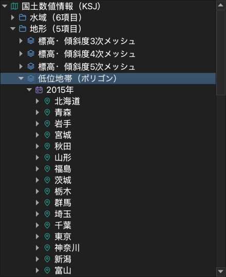
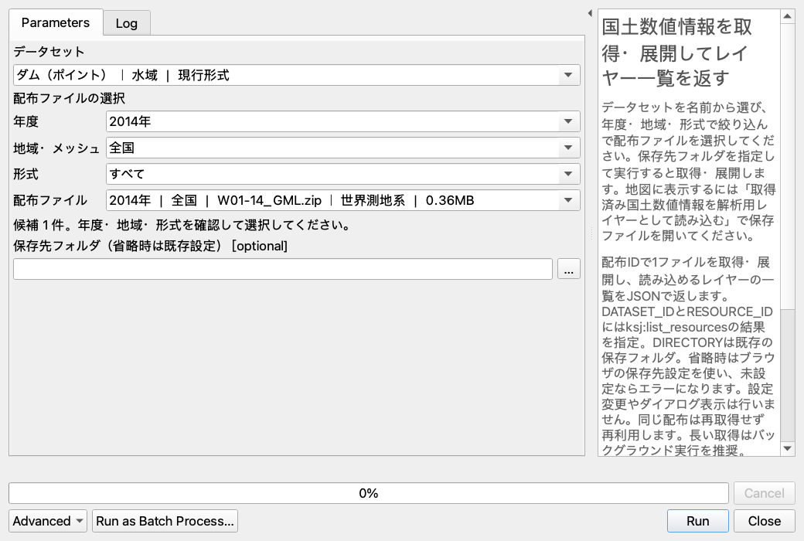

# ksj-provider — 国土数値情報 QGIS プラグイン

[国土数値情報の公式サイト](https://nlftp.mlit.go.jp/ksj/)の現行形式・過年度版・旧形式を、QGISのブラウザパネルから探して利用できます。公式一覧の分類と配布ファイルの情報を同梱し、起動時に全データをダウンロードする必要はありません。

Processingツールボックスから、データを検索・取得し、地図表示や解析に利用できます。

## 使い方

1. QGISのブラウザパネルで「国土数値情報」を展開します。先頭の「追加方法」項目に、現在の追加方法・保存先が表示されます。ダブルクリックして設定できます。
2. 水域・土地利用・災害／防災・施設・交通などの分類からデータを選びます。
3. 年度（新しい順）、地域・メッシュ、市区町村（該当データのみ）を選びます。
4. 形式・河川名・測地系・容量を確認してZIPを展開します。この段階ではZIPの目次だけを部分取得し、データ本体を保存・解凍しません。
5. ファイルをダブルクリック、またはマップへドラッグすると、必要なファイルを取得して追加します。初回に追加方法が未設定の場合は、ここで設定します。GML・GeoPackageなど複数レイヤーを含むファイルは、追加時にサブレイヤーを調べてまとめて追加します。

取得・追加の処理中は、対象ファイルの行に回転アイコンと「読み込み中…」を表示します。完了・失敗・キャンセル時は元の表示に戻ります。右クリックから追加した場合も同じ表示になります。


全国一括・都道府県別・メッシュ別・河川別の配布を保持し、同じ地域のSHP／GML／GeoJSONや異なる測地系を省略しません。都市計画決定情報は都道府県→市区町村から選択できます。

フォルダは分類、積層アイコンはデータ、カレンダーは年度、ピンは地域、ZIPアイコンは圧縮された配布ファイルを示します。分類には項目数を表示し、データ・年度・地域の配布ファイル数はマウスを重ねると確認できます。

データセットを右クリックすると、公式の説明・属性定義・利用条件を開けます。配布ファイルを右クリックすると、その版の説明ページまたは原本ダウンロードを開けます。最新版と旧版で利用条件が異なる場合があるため、使用する版の条件を確認してください。

### 追加方法・保存先と再利用

「追加方法・保存先」の設定画面で、次のどちらかを選びます。一度設定すると、別のプロジェクトでも同じ方法を使います。

- **フォルダに保存して追加**: 選択したレイヤーに必要なファイルを保存します。次回からは保存済みデータを再利用し、プロジェクトを開き直しても通常ファイルを参照します。
- **一時レイヤーとして追加**: ベクタはメモリ上のレイヤーに変換し、取得時の作業ファイルを削除します。保存先フォルダの指定は不要です。ラスタは一時ファイルを参照し、レイヤーを閉じると削除します。**プロジェクト保存だけでは一時データは残りません。** 残したいレイヤーは別途ファイルへ保存してください。

ZIP・フォルダの閲覧には保存先の設定が不要です。ZIPの目次取得には少量の通信が発生します。Shapefileは同じフォルダ・同じ名前の `.shp`・`.shx`・`.dbf` と、存在する `.prj`・`.cpg` などを一組として取得します。別のレイヤーや配布全体をまとめて取得しません。GMLのスキーマ、CSV・ラスタの付属ファイルも対象形式に応じて取得します。

保存データは配布ファイル名と識別子のフォルダ直下に、ZIP内のフォルダ構造を保って配置します。同じZIPから別のレイヤーを追加すると、同じ配布フォルダにファイルを追加します。全体取得も同じ保存先を使います。同名の別配布は外側の識別子で区別します。取得状態・目次・作業ファイルは隠しフォルダ `.ksj` に分け、失敗・取消時には今回追加した途中データを削除します。進捗の確認・取消はQGISのタスクから行えます。

「国土数値情報」または配布ファイルの右クリックからも「追加方法・保存先を設定…」を開けます。設定変更はすでにブラウザに表示されている項目にも、次回の追加時から反映されます。既存レイヤーや保存済みファイルは移動しません。設定を取り消した場合は元の状態を保ちます。


配布元がHTTPの部分取得に対応しない場合や、圧縮された入れ子ZIPの内部を閲覧する場合は、自動で全体取得せず案内を表示します。必要なら右クリックの「配布ファイルをダウンロード」から全体を取得してください。外部データを参照するVRTも全体取得が必要です。

保存したデータは自動更新・自動削除しません。公開元が同じURLのファイルを更新し、取り直す必要がある場合は、使用中のレイヤーを閉じ、保存先から対象配布のサブフォルダ（配布ファイル名で始まるフォルダ）を削除した後に再読み込みしてください。利用中のデータを削除・移動すると、保存したプロジェクトからも参照できなくなります。

**プロジェクトを共有するときは、参照する保存データも一緒に共有してください。** 受け手が参照できる共有フォルダを使うか、プロジェクトとデータの配置を保って渡します。

QGISのプロジェクト設定でパスを「相対」にすると、プロジェクトと保存したデータの配置を保ったまま移動できます。入れ子ZIPから展開したファイルも同様です。Shapefileなどは必要な付属ファイルを含め、配布単位のフォルダごと共有してください。

### 地図のメッシュをクリックして追加する

道路などメッシュ番号で配布されるデータは、番号を調べずに地図から選べます。

1. ブラウザでデータの**年度**を展開し、先頭の格子と「＋」のアイコンが付いた**「メッシュ索引を地図に追加」**をダブルクリックします。年度の右クリックメニューからも実行できます。
2. 配布があるメッシュの枠と番号が表示され、地物アクションのツールに切り替わります。背景地図と重ね、必要な場所へ移動・拡大してください。
3. メッシュ内をクリックします。複数の配布がある場合は、形式・測地系・容量などを確認してファイルを選びます。1件だけの場合は配布ファイルの選択を省略します。保存先が未設定なら、このとき一度だけフォルダを選びます。
4. 配布ファイル内に複数のレイヤーがある場合は、追加したいレイヤーにチェックを入れ、**「選択したレイヤーを追加」**を押します。複数選択できます。レイヤー名と拡張子付きのファイル名を確認し、同じ内容のSHP／GeoJSONなどから必要なものだけを選んでください。レイヤーが1つだけの場合はそのまま追加します。
5. 索引を選択したまま、続けて別のメッシュをクリックできます。同じ配布ファイルを再度選ぶと、まだ追加していないレイヤーを選択できます。

移動・拡大などでツールを切り替えた後は、索引レイヤーを選び、QGIS の**「地物アクションの実行」**に戻してください。「地物情報を表示」の結果や属性テーブルの地物アクションからも「このメッシュのデータを追加」を実行できます。

索引の作成はオフラインで行い、未取得データのダウンロードはクリック後に開始します。保存済みなら通信せず読み込みます。取得の進捗確認・中止はQGISのタスクから行えます。読み込み中の同じ配布への連打や追加済みレイヤーの重複を防ぎ、削除したレイヤーは再度クリックして追加できます。取得失敗はメッセージバーに表示され、同じ操作で再試行できます。

索引はプロジェクトに保存されます。再度開いて使用する際も KSJ プラグインを有効にしてください。対象は同梱カタログの配布単位である **1次メッシュ（4桁、約80km）**です。1km・500mなどのデータでも、索引は配布ファイルの単位を示します。世界測地系で位置を示す案内用の枠であり、旧日本測地系のデータの厳密な境界には使えません。

実装と動作確認の詳細は[メッシュ索引の検証記録](specs/005-mesh-index/verification.md)を参照してください。



[明るい背景での表示例](imgs/browser-panel-light.png)

旧形式は「JPGIS1.0（XML）」「旧統一フォーマット（シェープ・XML）」「旧統一フォーマット（TXT・CSV）」にまとめています。Shapefile、GeoJSON、GDAL対応GML/XML、GeoPackage、CSV、ラスタなどはQGISで開けます。独自仕様の旧XML・TXTやLZHなど、GDALで直接読めない形式は原本をダウンロードして利用します。入れ子ZIPを含む配布全体の取得・展開にはProcessingも利用できます。

## Processingツールボックスから利用する

プラグインを有効化すると、Processingツールボックスの「国土数値情報（KSJ）」に4つの処理が表示されます。更新後はプラグインを再読み込みしてください。

ブラウザの追加方法の設定は、ブラウザのファイル項目からの追加に適用します。Processingの取得処理とメッシュ索引からの取得は、指定フォルダに配布全体を保存する処理です。

### データを選んで取得する

1. **「国土数値情報を取得・展開してレイヤー一覧を返す」**を開きます。
2. **データセット**を名称から選びます。入力欄に名前の一部を入力すると候補を探せます。分類と版も併記しています。
3. **年度 → 地域・メッシュ → 形式**で候補を絞り、**配布ファイル**を選びます。ファイル名・測地系・容量などを確認できます。「すべて」に戻すと絞り込みを解除します。
4. **保存先フォルダ**を参照ボタンから選び、実行します。省略時はブラウザで設定した保存先を使います。未設定の場合は既存のフォルダを指定してください。

データセットを変更すると、以前の配布選択は解除されます。選択中の年度に配布がある地域・形式だけが候補になります。同じ配布は再ダウンロード・再解凍せず再利用し、取得はQGISの進捗画面から中止できます。



### 保存したデータを地図へ読み込む

1. **「取得済み国土数値情報を解析用レイヤーとして読み込む」**を開きます。
2. **ファイル**の参照ボタンから、保存先に展開されたSHP・GeoJSON・GML・GeoPackage・ラスタ等を選びます。
3. **レイヤー**のプルダウンから読み込み対象を選びます。複数レイヤーを含むファイルも個別に選択できます。データの種類は選択したファイルに応じて自動設定されます。
4. 必要ならレイヤー名を指定し、実行します。選んだレイヤーが地図に追加され、後続のProcessing解析に利用できます。

SHPとGMLの両方が同梱されている場合などは内容が重複するため、必要なものだけを選んでください。元のCRS・属性は保持します。距離や面積を扱う解析では適切な投影座標系へ変換してください。

### 分類や配布条件を調べる

**「国土数値情報のデータセットを検索」**では分類・版を選択し、検索語を指定できます。**「国土数値情報の配布ファイルを検索」**ではデータセットを選ぶと、そのデータの年度・地域・形式が候補に表示されます。検索は同梱カタログを使用し、通信しません。

検索語は空白区切りのAND検索、その他の検索条件は部分一致です。候補にない語を入力して絞り込むこともできます。地域には「東京／東京都」、形式には「シェープファイル形式／SHP」などの表記揺れがあります。結果が見つからない場合は条件を減らして候補の表記を確認してください。検索結果は実行ログの `RESULTS`（JSON）で確認できます。

### Python・バッチ処理で利用する

| アルゴリズムID          | 主な入力                                              | 出力                                                |
| ----------------------- | ----------------------------------------------------- | --------------------------------------------------- |
| `ksj:search_datasets`   | `QUERY`、`CATEGORY`、`EDITION`                        | 検索結果の `RESULTS` JSON、総件数 `TOTAL`           |
| `ksj:list_resources`    | `DATASET_ID`、`YEAR`、`REGION`、`FORMAT`、`QUERY`     | 配布一覧の `RESULTS` JSON、総件数 `TOTAL`           |
| `ksj:download_resource` | `DATASET_ID`、`RESOURCE_ID`、`DIRECTORY`              | `LOCAL_PATH`、取得元・レイヤー一覧の `RESULTS` JSON |
| `ksj:load_layer`        | `SOURCE`、`PROVIDER`（`ogr` / `gdal`）、任意の `NAME` | 単一レイヤー `OUTPUT`                               |

通常のダイアログでは表示名から選べます。Python・バッチ・モデルでは従来どおりIDや文字列の値を指定します。検索・配布一覧のJSONに含まれる `id` / `resource_id` を後続処理に利用できます。`LIMIT`（既定20、最大100）と `OFFSET`（既定0）でページを指定し、JSONの `next_offset` が `null` なら最終ページです。

```python
import processing

print(processing.run("ksj:search_datasets", {
    "QUERY": "ダム", "EDITION": "現行形式",
})["RESULTS"])
processing.algorithmHelp("ksj:download_resource")
```

`processing.run("ksj:load_layer", {...})["OUTPUT"]` はレイヤーオブジェクトを返します。Pythonからの実行ではプロジェクトへ自動追加しないため、表示する場合は `QgsProject.instance().addMapLayer(layer)`、解析する場合は次の処理の入力へ渡してください。

取得結果の `layers` が空の場合は、保存データがQGISで直接読めない形式の可能性があります。`unreadable_files` と警告を確認してください。公式説明・利用条件は検索結果に含まれる `source_url` から確認できます。出力レイヤーは保存済みファイルを参照するため、プロジェクト保存後も取得フォルダを保持し、共有時はデータも一緒に共有してください。

## 収録範囲と更新

カタログの取得日、一覧項目数、ページ数、重複を除いた配布ファイル数、取得エラーは [`ksj/catalog/index.json`](ksj/catalog/index.json) に記録しています。分類を展開するだけでは通信せず、データセット定義は選択時に読み込みます。ZIPの展開時にはファイル名を列挙するための目次を部分取得し、レイヤー追加時に必要なデータを取得します。公式サイトの配布状態や回線により、取得できない場合はブラウザにエラーを表示します。

収録範囲の照合・代表データの読み込み・テスト結果は[検証記録](specs/004-complete-catalog/verification.md)を参照してください。

更新にはPython 3.9以上とcurlを使用します。全配布ZIPのミラーは作成せず、公開HTMLと都市計画の配布一覧だけを収集します。

```bash
python3 scripts/update_catalog.py --refresh
```

- 現行一覧と3種類の旧形式一覧から、関連する詳細ページ・旧版を辿ります。
- 公開された正確なURL、年度、地域、市区町村、形式、測地系、容量、説明ページを保持します。
- HTMLの結合セル、和暦、相対URL、JavaScriptの配布一覧に対応します。
- 巡回と解析は逐次実行し、通信は既定で1秒の間隔を空けます。`--request-delay`で調整できます。`--workers`は廃止しました。
- HTMLキャッシュは `.cache/ksj-catalog/` に保存します。`--refresh`を省略すると再利用します。
- 取得失敗時は通常の更新を中止し、既存カタログを上書きしません。画像認証を通常のデータページとして登録しません。
- 索引を含む全JSONの書き込みが成功した後、出力先直下の不要なJSONを削除します。`--output`にはカタログ専用のディレクトリを指定してください。通常更新の取得失敗・書き込み失敗時にはこの削除を行いません。
- 画像認証が出た場合は利用者がブラウザで認証を完了した後、`--retry-failed`で認証画面のキャッシュを再取得できます。
- `--allow-incomplete`は調査用です。失敗を明示した未完了カタログを出力するため、通常の更新には使用しません。

更新処理は `scripts/update_catalog.py` に統一しています。

## 開発環境

### Docker でテスト（推奨）

Docker が動作する環境で、リポジトリのルートから次を実行します。ホスト側に QGIS や Python のテスト依存をインストールする必要はありません。

```bash
bash scripts/test-docker.sh
```

公式の `qgis/qgis:3.44` イメージ内で、QGIS のシステムパッケージを共有する一時仮想環境に `pytest`・`pytest-qgis`・`pytest-cov` をインストールし、Xvfb 上で全テストと `ksj`・`scripts` のカバレッジを実行します。初回はイメージ取得、各実行時はテスト依存の取得にネットワーク接続が必要です。終了後にコンテナと仮想環境は削除されます。

QGIS のバージョンや pytest の引数を指定できます。引数を渡した場合は既定の `-v` とカバレッジ引数を置き換えます。

```bash
QGIS_TEST_IMAGE=qgis/qgis:3.40 bash scripts/test-docker.sh
QGIS_TEST_IMAGE=qgis/qgis:4.0-trixie bash scripts/test-docker.sh
bash scripts/test-docker.sh tests/test_catalog.py -q
```

公式イメージに合わせて既定では `linux/amd64` を使います。Apple Silicon では Docker Desktop の AMD64 エミュレーションを有効にしてください。プラットフォームは `DOCKER_DEFAULT_PLATFORM` で変更できます。

GitHub Actions でも同じスクリプトを使い、QGIS 3.40（最低対応版）・3.44・4.0 のテストとカバレッジを実行します。別のジョブで Ruff の lint・format を確認します。Pull Request、`main` への push、Actions 画面からの手動実行に対応しています。

### ローカルで lint

```bash
uv sync --locked
uv run --no-sync ruff check .
uv run --no-sync ruff format --check .
```

### QGIS をインストールした環境でテスト

プラグインの最低QGISバージョンは [`metadata.txt`](metadata.txt) を参照してください。QGIS付属Pythonとシステムサイトパッケージを共有し、別のPyQtをインストールしないでください。

```bash
uv venv --python /Applications/QGIS.app/Contents/MacOS/bin/python3 --system-site-packages
source setup_qgis_env.sh
uv pip install --python .venv/bin/python pytest pytest-qgis pytest-cov
QT_QPA_PLATFORM=offscreen .venv/bin/python -m pytest -q
QT_QPA_PLATFORM=offscreen .venv/bin/python -m pytest --cov=ksj --cov=scripts --cov-report=term-missing
uv run ruff check .
```

Windowsでは、QGISをインストールした環境の **OSGeo4W Shell** を開き、QGIS付属Pythonを指定して仮想環境を作成します。以下は `C:\OSGeo4W` にQGISを入れた例です。スタンドアロン版やLTRでは、インストール先と `apps\qgis` の部分を実際のパス（例: `apps\qgis-ltr`）に置き換えてください。

```bat
cd C:\path\to\ksj-provider
set "QGIS_PREFIX_PATH=C:\OSGeo4W\apps\qgis"
set "PYTHONPATH=%QGIS_PREFIX_PATH%\python;%PYTHONPATH%"
set "PATH=%QGIS_PREFIX_PATH%\bin;%PATH%"
python -c "import sys; print(sys.executable)"
uv venv --python "C:\OSGeo4W\bin\python3.exe" --system-site-packages
.venv\Scripts\python.exe -c "from qgis.core import Qgis; print(Qgis.QGIS_VERSION)"
uv pip install --python .venv\Scripts\python.exe pytest pytest-qgis pytest-cov
.venv\Scripts\python.exe -m pytest -q
```

`uv venv --python` には、直前のコマンドで確認したQGIS付属Pythonの実際のパスを指定します。QGISのモジュールとDLLの探索には環境変数が必要です（[QGIS公式開発ガイド](https://docs.qgis.org/latest/en/docs/pyqgis_developer_cookbook/intro.html#running-custom-applications)）。上記のWindows手順はこの変更では実機未検証です。

VS CodeではPython拡張機能を有効にし、コマンドパレットの **Python: Select Interpreter** → **Enter interpreter path** から、Windowsは `.venv\Scripts\python.exe`、macOSは `.venv/bin/python` を選択します。Windowsでは環境設定済みのOSGeo4W Shellから `code .` で起動し、統合ターミナルでも `from qgis.core import Qgis` のインポートが通ることを確認してください。既存のVS Codeプロセスが環境を引き継がない場合は、すべてのウィンドウを終了してから起動し直します。

標準ライブラリだけを使う解析・分類テストは、QGISなしでも実行できます。

macOSでQGIS付属Pythonをターミナルから実行し、GDALが `unable to get local issuer certificate` を返す場合は、OS標準CAファイルの存在を確認して `CURL_CA_BUNDLE=/etc/ssl/cert.pem` を実行時に指定します。証明書検証を無効化する必要はありません。

```bash
python3 -m unittest tests.test_update_catalog tests.test_catalog
```

## 構成

| パス                           | 役割                                                             |
| ------------------------------ | ---------------------------------------------------------------- |
| `ksj/catalog/index.json`       | 分類・データセット索引・収集結果                                 |
| `ksj/catalog/*.json`           | データセットごとの配布ファイル定義                               |
| `ksj/catalog.py`               | 遅延読み込み・年度や地域の分類                                   |
| `ksj/catalog_fields.py`        | 収集と表示で共有する公式配布表の列名定義                         |
| `ksj/catalog_browser.py`       | 分類・配布ファイル・ZIP内のファイル・設定表示のブラウザ項目     |
| `ksj/remote_zip.py`            | ZIPの目次と選択したレイヤー一式の部分取得                       |
| `ksj/layer_loading.py`         | 保存／一時レイヤーの非同期追加・取消・ドラッグ対応               |
| `ksj/mesh_index.py`            | 配布メッシュ索引・地物アクション・非同期読み込み                 |
| `ksj/processing_provider.py`   | Processingプロバイダの登録・アルゴリズム一覧                     |
| `ksj/processing_widgets.py`    | Processingの選択式入力画面                                       |
| `ksj/processing_algorithms.py` | 検索・配布一覧・取得・解析用レイヤー出力                         |
| `ksj/browser.py`               | QGISプロバイダ・ルート項目                                       |
| `ksj/local_storage.py`         | 保存先設定・データの取得と解凍・再利用                           |
| `ksj/zip_scanner.py`           | ローカルフォルダ・ZIPの探索とレイヤー候補の分類                  |
| `scripts/update_catalog.py`    | 公式カタログ生成                                                 |
| `tests/`                       | HTML解析・分類・実QGISでの回帰テスト                             |
| `specs/004-complete-catalog/`  | 全データ対応の計画と検証記録                                     |

パッケージ内部では相対インポートを使用し、Plugin Reloaderとの互換性を保ちます。

## ライセンス

プラグインはMITライセンスです。国土数値情報のデータは各版の使用許諾条件に従ってください。
