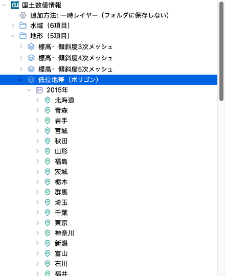
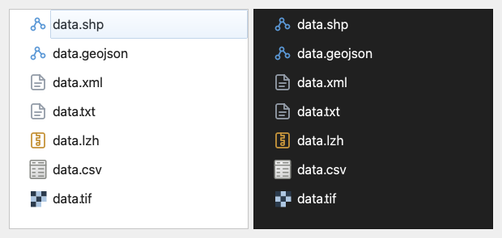
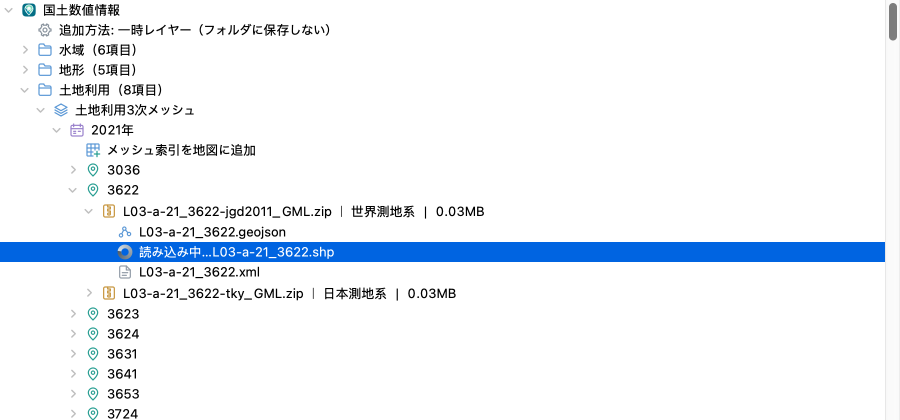
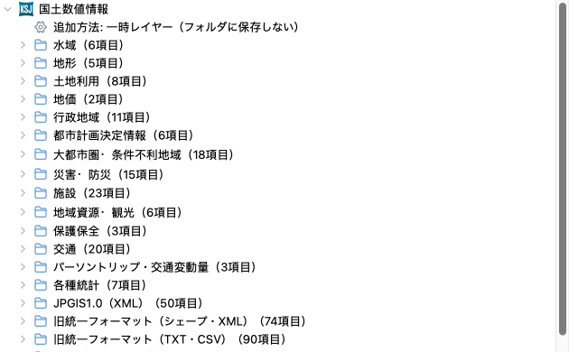
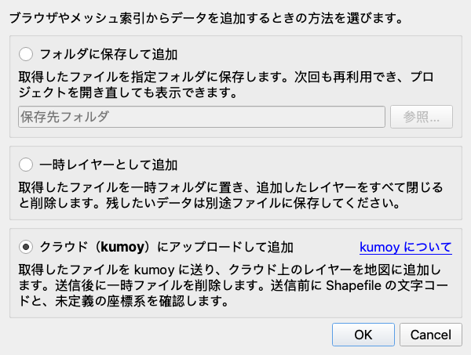
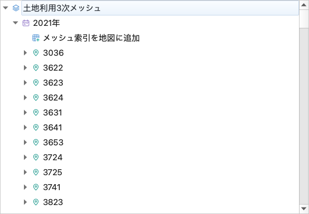
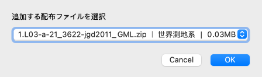
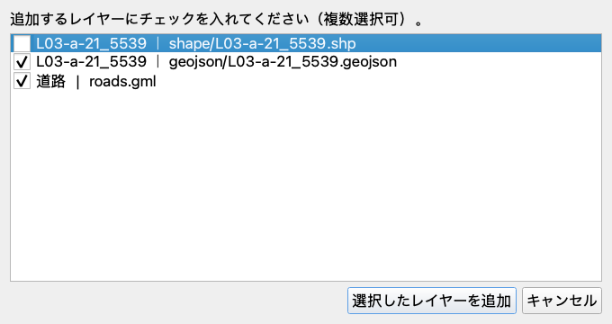
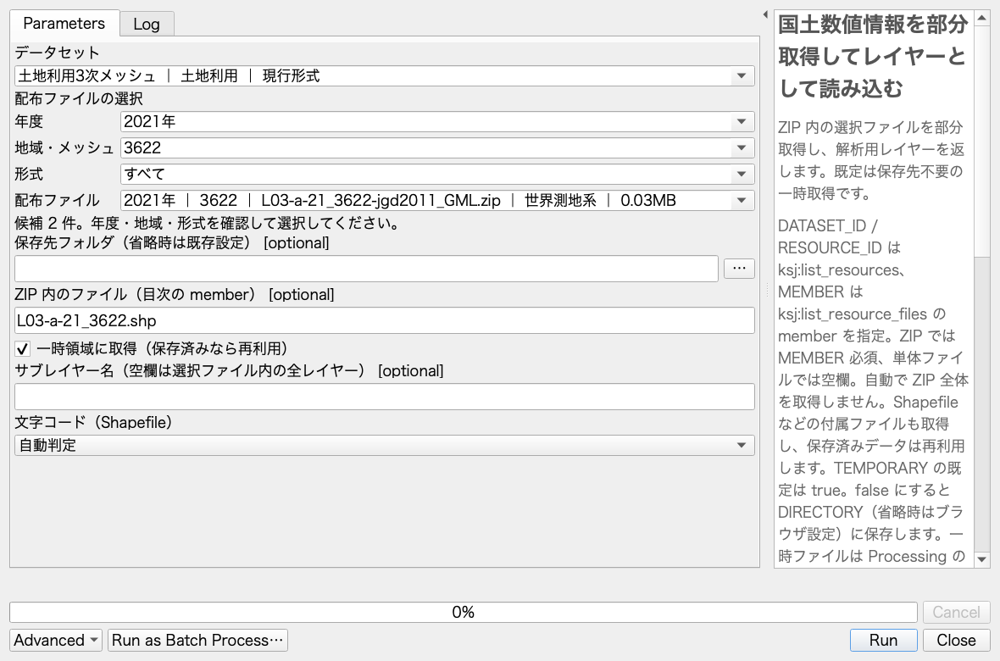

# 国土数値情報ブラウザ QGIS Plugin（KSJ Browser）


[国土数値情報の公式サイト](https://nlftp.mlit.go.jp/ksj/)の現行形式・過年度版・旧形式を、QGIS のブラウザパネルから探して地図に追加できます。公式一覧の分類と配布ファイルの情報を同梱しているため、起動時に全データをダウンロードする必要はありません。データ本体は、レイヤーを追加するときに必要なファイルだけを取得します。

Processing ツールボックスにも、検索・取得・読み込みのアルゴリズム（プロバイダ `ksj`）があります。一覧は「[Processing アルゴリズム](#processing-アルゴリズム)」を参照してください。

QGIS 3.44 以上 4.x まで（Qt 5・Qt 6 の両方）に対応します。



## ブラウザパネルで使う

### データを探す

1. QGIS のブラウザパネルで「国土数値情報」を展開します。
2. 水域・土地利用・災害／防災・施設・交通などの分類からデータを選びます。
3. 年度（新しい順）、地域・メッシュ、市区町村（該当データのみ）を選びます。
4. 形式・河川名・測地系・容量を確認して ZIP を展開します。この段階では ZIP の目次だけを部分取得し、データ本体を保存・解凍しません。

全国一括・都道府県別・メッシュ別・河川別の配布を保持し、同じ地域の SHP／GML／GeoJSON や異なる測地系を省略しません。都市計画決定情報は都道府県 → 市区町村の順に選択できます。

フォルダは分類、積層アイコンはデータ、カレンダーは年度、ピンは地域、ZIP アイコンは圧縮された配布ファイルを示します。ZIP 内のファイルは、ベクタ・文書・圧縮ファイル・表・ラスタの種類ごとに異なるアイコンで示します。分類には項目数を表示し、データ・年度・地域の配布ファイル数はマウスを重ねると確認できます。



データセットを右クリックすると、公式の説明・属性定義・利用条件を開けます。配布ファイルを右クリックすると、その版の説明ページまたは原本ダウンロードを開けます。最新版と旧版で利用条件が異なる場合があるため、使用する版の条件を確認してください。

旧形式は「JPGIS1.0（XML）」「旧統一フォーマット（シェープ・XML）」「旧統一フォーマット（TXT・CSV）」にまとめています。Shapefile、GeoJSON、GDAL 対応の GML/XML、GeoPackage、CSV、ラスタなどは QGIS で開けます。独自仕様の旧 XML・TXT や LZH など、GDAL で直接読めない形式は原本をダウンロードして利用します。入れ子 ZIP を含む配布全体の取得・展開には、Processing の取得アルゴリズムも使えます。

### レイヤーを追加する

ファイルをダブルクリック、またはマップへドラッグすると、必要なファイルを取得して追加します。初回に追加方法が未設定の場合は、ここで設定します。GML・GeoPackage など複数レイヤーを含むファイルは、追加時にサブレイヤーを調べてまとめて追加します。

取得・追加の処理中は、対象ファイルの行に回転アイコンと「読み込み中…」を表示します。完了・失敗・キャンセル時は元の表示に戻ります。右クリックから追加した場合も同じ表示になります。進捗の確認・取消は QGIS のタスクから行えます。



ZIP・フォルダの閲覧には保存先の設定が不要です。ZIP の目次取得には少量の通信が発生します。Shapefile は同じフォルダ・同じ名前の `.shp`・`.shx`・`.dbf` と、存在する `.prj`・`.cpg` などを一組として取得します。別のレイヤーや配布全体をまとめて取得しません。GML のスキーマ、CSV・ラスタの付属ファイルも対象形式に応じて取得します。

配布元が HTTP の部分取得に対応しない場合や、圧縮された入れ子 ZIP の内部を閲覧する場合は、自動で全体取得せず案内を表示します。必要なら右クリックの「配布ファイルをダウンロード」から全体を取得してください。外部データを参照する VRT も全体取得が必要です。

### 追加方法・保存先を設定する

ブラウザの「国土数値情報」の先頭にある「追加方法」の項目に、現在の追加方法・保存先を表示します。この項目をダブルクリックするか、「国土数値情報」または配布ファイルの右クリックから「追加方法・保存先を設定…」を選ぶと、設定画面が開きます。一度設定すると、別のプロジェクトでも同じ方法を使います。



設定画面では、次のいずれかを選びます。

- **フォルダに保存して追加**: 取得したファイルを指定フォルダに保存し、次回から再利用します。
- **一時レイヤーとして追加**: 取得したファイルを一時フォルダに置き、そのファイルから追加したレイヤーをすべて閉じると削除します。



設定変更は、すでにブラウザに表示されている項目にも、次回の追加時から反映されます。既存レイヤーや保存済みファイルは移動しません。設定を取り消した場合は元の状態を保ちます。

追加方法の設定は、ブラウザのファイル項目とメッシュ索引からの追加に適用します。Processing では `TEMPORARY` で一時取得・保存を明示し、`MEMBER` で ZIP 内の取得対象を指定します。保存先を省略した場合は、ここで設定した保存先を参照します。詳細は「[Processing アルゴリズム](#processing-アルゴリズム)」を参照してください。

保存先に取得済みのデータがあれば、いずれの方式でも通信せず再利用します。

#### フォルダに保存して追加

選択したレイヤーに必要なファイルを保存先フォルダに保存します。次回からは保存済みデータを再利用し、プロジェクトを開き直しても通常ファイルを参照します。保存先の構成、公開元が更新されたときの取り直し、プロジェクト共有時の注意は「[保存したデータの扱い](#保存したデータの扱い)」を参照してください。

#### 一時レイヤーとして追加

ベクタ・ラスタとも取得したファイルを一時フォルダに置き、そのまま参照します。保存先フォルダの指定は不要です。QGIS の「レイヤーを複製」で作った複製も含め、同じ一時フォルダを参照するレイヤーをすべて閉じると一時フォルダを削除します。元のレイヤーを閉じても、プロジェクトに追加した複製は引き続き利用できます。

**プロジェクト保存だけでは一時データは残りません。** 残したいレイヤーは別途ファイルへ保存してください。メッシュ索引から追加する場合は配布ファイル全体を一時フォルダへ取得します。

### 地図のメッシュをクリックして追加する

道路などメッシュ番号で配布されるデータは、番号を調べずに地図から選べます。

1. ブラウザでデータの**年度**を展開し、先頭の格子と「＋」のアイコンが付いた**「メッシュ索引を地図に追加」**をダブルクリックします。年度の右クリックメニューからも実行できます。

   

2. 配布があるメッシュの枠と番号が表示され、地物アクションのツールに切り替わります。背景地図と重ね、必要な場所へ移動・拡大してください。
3. メッシュ内をクリックします。複数の配布がある場合は、形式・測地系・容量などを確認してファイルを選びます。1 件だけの場合は配布ファイルの選択を省略します。追加方法・保存先の設定に従います。「フォルダに保存して追加」で保存先が未設定なら、このとき一度だけフォルダを選びます。

   

4. 配布ファイル内に複数のレイヤーがある場合は、追加したいレイヤーにチェックを入れ、**「選択したレイヤーを追加」**を押します。複数選択できます。レイヤー名と拡張子付きのファイル名を確認し、同じ内容の SHP／GeoJSON などから必要なものだけを選んでください。レイヤーが 1 つだけの場合はそのまま追加します。

   

5. 索引を選択したまま、続けて別のメッシュをクリックできます。「フォルダに保存して追加」では、同じ配布ファイルを再度選ぶと、まだ追加していないレイヤーを選択できます。「一時レイヤーとして追加」では毎回すべてのレイヤーを候補に出します。

移動・拡大などでツールを切り替えた後は、索引レイヤーを選び、QGIS の**「地物アクションの実行」**に戻してください。「地物情報を表示」の結果や属性テーブルの地物アクションからも「このメッシュのデータを追加」を実行できます。

この操作は 本プラグインが提供するため、QGIS 4 の埋め込みスクリプトの信頼確認は不要です。プロジェクトを保存していなくても利用できます。

索引の作成はオフラインで行い、未取得データのダウンロードはクリック後に開始します。保存済みなら通信せず読み込みます。取得の進捗確認・中止は QGIS のタスクから行えます。読み込み中の同じ配布への連打を防ぎます。「フォルダに保存して追加」では追加済みレイヤーの重複も防ぎ、削除したレイヤーは再度クリックして追加できます。取得失敗はメッセージバーに表示され、同じ操作で再試行できます。

索引はプロジェクトに保存されます。再度開いて使用する際も プラグインを有効にしてください。対象は同梱カタログの配布単位である **1 次メッシュ（4 桁、約 80 km）** です。1 km・500 m などのデータでも、索引は配布ファイルの単位を示します。世界測地系で位置を示す案内用の枠であり、旧日本測地系のデータの厳密な境界には使えません。

## 保存したデータの扱い

### 保存先の構成

保存データは配布ファイル名と識別子のフォルダ直下に、ZIP 内のフォルダ構造を保って配置します。同じ ZIP から別のレイヤーを追加すると、同じ配布フォルダにファイルを追加します。全体取得も同じ保存先を使います。同名の別配布は外側の識別子で区別します。取得状態・目次・作業ファイルは隠しフォルダ `.ksj` に分け、失敗・取消時には今回追加した途中データを削除します。

### 公開元が更新されたとき

保存したデータは自動更新・自動削除しません。公開元が同じ URL のファイルを更新し、取り直す必要がある場合は、使用中のレイヤーを閉じ、保存先から対象配布のサブフォルダ（配布ファイル名で始まるフォルダ）を削除した後に再読み込みしてください。利用中のデータを削除・移動すると、保存したプロジェクトからも参照できなくなります。

### プロジェクトを共有する

**プロジェクトを共有するときは、参照する保存データも一緒に共有してください。** 受け手が参照できる共有フォルダを使うか、プロジェクトとデータの配置を保って渡します。

QGIS のプロジェクト設定でパスを「相対」にすると、プロジェクトと保存したデータの配置を保ったまま移動できます。入れ子 ZIP から展開したファイルも同様です。Shapefile などは必要な付属ファイルを含め、配布単位のフォルダごと共有してください。

## 文字コード

Shapefile の文字コードは、取得したファイルの属性値と `.cpg`・言語 ID・フォルダ名から自動判定して適用します。レイヤーの文字コード設定を変更した場合はメッセージログ（タグ `KSJ`）で確認できます。判定できない場合は QGIS の既定に従うため、文字化けしたときはレイヤープロパティで文字コードを変更してください。

UTF-8 と cp932 の両方で復号できる値（一部の半角カナなど）は UTF-8 を優先するため、誤判定する場合があります。その場合もレイヤープロパティ、または Processing の読み込みアルゴリズムの文字コード指定で変更してください。Shift_JIS は拡張漢字や丸数字を保持するため CP932 として読み込みます。GeoJSON・GML・GeoPackage は UTF-8 固定です。

## 収録範囲とカタログの更新

カタログの取得日、一覧項目数、ページ数、重複を除いた配布ファイル数、取得エラーは [`ksj/catalog/index.json`](ksj/catalog/index.json) に記録しています。分類を展開するだけでは通信せず、データセット定義は選択時に読み込みます。ZIP の展開時にはファイル名を列挙するための目次を部分取得し、レイヤー追加時に必要なデータを取得します。公式サイトの配布状態や回線により、取得できない場合はブラウザにエラーを表示します。

収録範囲の照合・代表データの読み込み・テスト結果は[検証記録](specs/004-complete-catalog/verification.md)を参照してください。

更新には Python 3.9 以上と curl を使用します。全配布 ZIP のミラーは作成せず、公開 HTML と都市計画の配布一覧だけを収集します。

```bash
python3 scripts/update_catalog.py --refresh
```

- 現行一覧と 3 種類の旧形式一覧から、関連する詳細ページ・旧版を辿ります。
- 公開された正確な URL、年度、地域、市区町村、形式、測地系、容量、説明ページを保持します。
- HTML の結合セル、和暦、相対 URL、JavaScript の配布一覧に対応します。
- 巡回と解析は逐次実行し、通信は既定で 1 秒の間隔を空けます。`--request-delay` で調整できます。`--workers` は廃止しました。
- HTML キャッシュは `.cache/ksj-catalog/` に保存します。`--refresh` を省略すると再利用します。
- 取得失敗時は通常の更新を中止し、既存カタログを上書きしません。画像認証を通常のデータページとして登録しません。
- 索引を含む全 JSON の書き込みが成功した後、出力先直下の不要な JSON を削除します。`--output` にはカタログ専用のディレクトリを指定してください。通常更新の取得失敗・書き込み失敗時にはこの削除を行いません。
- 画像認証が出た場合は利用者がブラウザで認証を完了した後、`--retry-failed` で認証画面のキャッシュを再取得できます。
- `--allow-incomplete` は調査用です。失敗を明示した未完了カタログを出力するため、通常の更新には使用しません。

更新処理は `scripts/update_catalog.py` に統一しています。

## Processing アルゴリズム

プラグインを有効化すると、Processing ツールボックスの「国土数値情報」に次の 7 つのアルゴリズムが表示されます。プラグインを更新した後は再読み込みしてください。データセット・配布ファイルはダイアログで表示名から選べ、Python・バッチ・モデルビルダーでは ID と値を指定します。

| アルゴリズム ID         | 主な入力                                                                                                            | 出力                                                |
| ----------------------- | ------------------------------------------------------------------------------------------------------------------- | --------------------------------------------------- |
| `ksj:search_datasets`   | `QUERY`、`CATEGORY`、`EDITION`                                                                                      | 検索結果の `RESULTS` JSON、総件数 `TOTAL`           |
| `ksj:list_resources`    | `DATASET_ID`、`YEAR`、`REGION`、`FORMAT`、`QUERY`                                                                   | 配布一覧の `RESULTS` JSON、総件数 `TOTAL`           |
| `ksj:list_resource_files` | `DATASET_ID`、`RESOURCE_ID`、`QUERY`、任意の `DIRECTORY` | ZIP 目次の `RESULTS` JSON、総件数 `TOTAL` |
| `ksj:download_resource` | `DATASET_ID`、`RESOURCE_ID`、`MEMBER`、`DIRECTORY`、`TEMPORARY` | `LOCAL_PATH`、取得元・レイヤー一覧の `RESULTS` JSON |
| `ksj:load_resource` | `DATASET_ID`、`RESOURCE_ID`、`MEMBER`、任意の `SUBLAYER`・`ENCODING`・`DIRECTORY`・`TEMPORARY` | 取得して読み込んだ `LAYERS`、`LOCAL_PATH`、`RESULTS` JSON |
| `ksj:load_layer`        | `SOURCE`、`PROVIDER`（`ogr` / `gdal`）、任意の `NAME`、`ENCODING`（0: 自動判定、1: UTF-8、2: Shift_JIS、3: EUC-JP） | 単一レイヤー `OUTPUT`                               |
| `ksj:create_mesh_index` | `DATASET_ID`、`YEAR`、`REGION`、`FORMAT`、`QUERY` | 配布単位の一次メッシュ索引 `OUTPUT` |

入出力の詳細とページ指定（`LIMIT`・`OFFSET`）は、`processing.algorithmHelp("ksj:search_datasets")` のように確認できます。

### ZIP 内の必要なファイルだけを使う

`search_datasets` → `list_resources` → `list_resource_files` の順で探します。`list_resource_files` は ZIP の目次だけを部分取得し、`RESULTS.items` に `member`（ZIP 内のパス）、推定 `provider`、`partial_available`（付属ファイルを含め部分取得の対象にできるか）、`reason`（非対応理由）を返します。実際にサーバーが部分取得に応答するかは実行時に確認します。各一覧は `total` と `next_offset` を返し、`LIMIT`（既定 20、最大 100）・`OFFSET` で続きが取得できます。データセットの出典・利用条件、配布の年度・形式・測地系も結果に保持します。

選択した `member` を `load_resource` の `MEMBER` に渡すと、必要なファイルと付属ファイルだけを取得し、ベクタ・ラスタを標準の複数レイヤー出力 `LAYERS` として返します。Shapefile の文字コードは既定で自動判定します。GML・GeoPackage などはそのファイル内の全サブレイヤーが対象です。事前に `download_resource` で取得・列挙し、`RESULTS.layers[].name` を `SUBLAYER` に完全一致で指定すれば、対象を絞れます。



- `load_resource` は `TEMPORARY=true` が既定で、保存先の設定なしに利用できます。ZIP では `MEMBER` が必須です。単体ファイルでは空欄にします。
- `download_resource` は従来どおり `TEMPORARY=false` が既定です。`MEMBER` が空欄なら配布全体を取得・展開し、指定した場合だけ部分取得します。`TEMPORARY=true` にすれば一時取得もできます。
- `TEMPORARY=false` では既存フォルダを `DIRECTORY` に指定します。省略時はブラウザの保存先を使い、未設定ならエラーになります。処理中に設定ダイアログは表示しません。
- 保存済みデータは再利用します。部分取得できないサーバー、入れ子 ZIP、外部参照のある VRT は自動で全体取得せず案内します。全体取得が必要な場合は `download_resource` の `MEMBER` を空欄にしてください。

Processing の一時取得は **QGIS の Processing 一時領域**を使用し、別の呼び出しや結果レイヤーへの所有権移譲後も参照できます。ブラウザの一時レイヤーと異なり、レイヤーを閉じても直ちには削除しません。QGIS 終了後の保持は保証せず、プロジェクト保存だけでは永続化しません。残したいデータは `TEMPORARY=false` で取得するか別途エクスポートしてください。

### Mapsuke から呼ぶ

検索は `processing.run()`、通信を伴う目次取得・部分取得は `run_processing_in_background()` で実行できます。進捗・取消に対応し、`load_resource` の完了時には Mapsuke が `LAYERS` を地図へ追加します。通常の Python から `processing.run()` で呼ぶ場合は、返されたレイヤーを後続解析へ渡すか `QgsProject` へ追加してください。アルゴリズム本体はプロジェクトを変更しません。

まず検索結果の ID を確認します。

```python
import json
import processing

print(json.loads(processing.run("ksj:search_datasets", {"QUERY": "ダム"})["RESULTS"]))
```

`list_resources` で配布 ID を確認した後、Mapsuke では次のように目次を取得します。`<...>` は実際の検索結果で置き換えてください。

```python
run_processing_in_background("ksj:list_resource_files", {
    "DATASET_ID": "<データセットの id>",
    "RESOURCE_ID": "<配布の resource_id>",
})
```

目次の結果を確認した次の実行で、必要なファイルを読み込みます。Mapsuke は実行ごとに Python 変数が初期化されるため、引数を毎回指定します。

```python
run_processing_in_background("ksj:load_resource", {
    "DATASET_ID": "<データセットの id>",
    "RESOURCE_ID": "<配布の resource_id>",
    "MEMBER": "<目次の member>",
})
```

地図から配布メッシュを探す場合は `create_mesh_index` を使います。年度などの条件に一致した全配布が対象で、ページ数による取りこぼしはありません。出力には `mesh_code`・`file_count`・`resources`（配布情報 JSON）が入り、`resources` 内の `resource_id` を目次取得・部分取得へ渡せます。地図に追加した索引ではブラウザと同じ地物アクションも利用できます。範囲は一次メッシュの概略位置であり、データの厳密な収録範囲ではありません。

## 開発環境

### Docker でテスト（推奨）

Docker が動作する環境で、リポジトリのルートから次を実行します。ホスト側に QGIS や Python のテスト依存をインストールする必要はありません。

```bash
bash scripts/test-docker.sh
```

公式の `qgis/qgis:3.44` イメージ内で、QGIS のシステムパッケージを共有する一時仮想環境に [`requirements-test.txt`](requirements-test.txt) のテスト依存（`pytest`・`pytest-qgis`・`pytest-cov`、バージョン固定）をインストールし、Xvfb 上で全テストと `ksj`・`scripts` のカバレッジを実行します。カバレッジは端末に表示するほか `coverage.xml` に書き出します。初回はイメージ取得、各実行時はテスト依存の取得にネットワーク接続が必要ですが、pip のキャッシュを Docker ボリューム `ksj-test-pip-cache` に残すため 2 回目以降のダウンロードは省略されます。終了後にコンテナと仮想環境は削除されます。

QGIS のバージョンや pytest の引数を指定できます。引数を渡した場合は既定の `-v` とカバレッジ引数を置き換えます。

```bash
QGIS_TEST_IMAGE=qgis/qgis:4.0-trixie bash scripts/test-docker.sh
QGIS_TEST_IMAGE=qgis/qgis:4.2-trixie bash scripts/test-docker.sh
bash scripts/test-docker.sh tests/test_catalog.py -q
```

公式イメージに合わせて既定では `linux/amd64` を使います。Apple Silicon では Docker Desktop の AMD64 エミュレーションを有効にしてください。プラットフォームは `DOCKER_DEFAULT_PLATFORM` で変更できます。

GitHub Actions でも同じスクリプトを使い、QGIS 3.44（最低対応版）・4.0・4.2 のテストとカバレッジを実行し、各バージョンの `coverage.xml` を成果物として保存します。別のジョブで Ruff の lint・format、bandit によるセキュリティチェック、公式の pyqgis4-checker による Qt6 互換チェックを確認します。Pull Request、`main` への push、Actions 画面からの手動実行に対応しています。Actions のバージョン更新は Dependabot が月次で提案します。

### ローカルで lint

```bash
uv sync --locked
uv run --no-sync ruff check .
uv run --no-sync ruff format --check .
uv run --no-sync bandit -c pyproject.toml -l -r .
```

bandit は重大度に関係なく、指摘が 1 件でもあると失敗します。plugins.qgis.org もアップロード時に bandit で検査し、bandit 自身が Low とする指摘（例: 変数名に `token` や `password` を含む文字列定数の B105）でもその版をブロックするためです。ブロックされた版は公開できず、版を上げて出し直すしかありません。配布 ZIP に入らない `tests/`・`scripts/` などは `pyproject.toml` の `[tool.bandit]` で対象外にしています。

### Qt6 互換チェック

公式の [pyqgis4-checker](https://github.com/qgis/pyqgis4-checker) で、PyQt6 / QGIS 4 で動かない書き方（修飾のない enum など）を検出します。CI の Lint ワークフローと同じイメージ・同じスクリプトです。

```bash
docker run --rm --pull always --platform linux/amd64 --user "$(id -u):$(id -g)" \
  --workdir /workspace/ -v "$(pwd):/workspace/" \
  ghcr.io/qgis/pyqgis4-checker:main-ubuntu \
  pyqt5_to_pyqt6.py --dry_run --logfile /workspace/pyqt6_checker.log .
```

指摘は `pyqt6_checker.log`（`.gitignore` 済み）に書き出されます。`--dry_run` を外すとファイルを直接書き換えるので、コミット済みの状態で実行して差分を確認してください。イメージのタグ `main-ubuntu` は QGIS の更新に追従する移動タグで、Dependabot の管理対象外です。

### QGIS をインストールした環境でテスト

プラグインの対応 QGIS バージョン（`qgisMinimumVersion`・`qgisMaximumVersion`）は [`metadata.txt`](metadata.txt) を参照してください。QGIS 付属 Python とシステムサイトパッケージを共有し、別の PyQt をインストールしないでください。

```bash
uv venv --python /Applications/QGIS.app/Contents/MacOS/bin/python3 --system-site-packages
source setup_qgis_env.sh
uv pip install --python .venv/bin/python -r requirements-test.txt
QT_QPA_PLATFORM=offscreen .venv/bin/python -m pytest -q
QT_QPA_PLATFORM=offscreen .venv/bin/python -m pytest --cov=ksj --cov=scripts --cov-report=term-missing
uv run ruff check .
```

Windows では、QGIS をインストールした環境の **OSGeo4W Shell** を開き、QGIS 付属 Python を指定して仮想環境を作成します。以下は `C:\OSGeo4W` に QGIS を入れた例です。スタンドアロン版や LTR では、インストール先と `apps\qgis` の部分を実際のパス（例: `apps\qgis-ltr`）に置き換えてください。

```bat
cd C:\path\to\ksj-browser
set "QGIS_PREFIX_PATH=C:\OSGeo4W\apps\qgis"
set "PYTHONPATH=%QGIS_PREFIX_PATH%\python;%PYTHONPATH%"
set "PATH=%QGIS_PREFIX_PATH%\bin;%PATH%"
python -c "import sys; print(sys.executable)"
uv venv --python "C:\OSGeo4W\bin\python3.exe" --system-site-packages
.venv\Scripts\python.exe -c "from qgis.core import Qgis; print(Qgis.QGIS_VERSION)"
uv pip install --python .venv\Scripts\python.exe -r requirements-test.txt
.venv\Scripts\python.exe -m pytest -q
```

`uv venv --python` には、直前のコマンドで確認した QGIS 付属 Python の実際のパスを指定します。QGIS のモジュールと DLL の探索には環境変数が必要です（[QGIS 公式開発ガイド](https://docs.qgis.org/latest/en/docs/pyqgis_developer_cookbook/intro.html#running-custom-applications)）。Windows の手順は実機で未検証です。

VS Code では Python 拡張機能を有効にし、コマンドパレットの **Python: Select Interpreter** → **Enter interpreter path** から、Windows は `.venv\Scripts\python.exe`、macOS は `.venv/bin/python` を選択します。Windows では環境設定済みの OSGeo4W Shell から `code .` で起動し、統合ターミナルでも `from qgis.core import Qgis` のインポートが通ることを確認してください。既存の VS Code プロセスが環境を引き継がない場合は、すべてのウィンドウを終了してから起動し直します。

標準ライブラリだけを使う解析・分類テストは、QGIS なしでも実行できます。

```bash
python3 -m unittest tests.test_update_catalog tests.test_catalog
```

macOS で QGIS 付属 Python をターミナルから実行し、GDAL が `unable to get local issuer certificate` を返す場合は、OS 標準 CA ファイルの存在を確認して `CURL_CA_BUNDLE=/etc/ssl/cert.pem` を実行時に指定します。証明書検証を無効化する必要はありません。

### リリース

配布 ZIP の作成と QGIS 公式プラグインリポジトリ（[plugins.qgis.org](https://plugins.qgis.org/)）への投稿は、GitHub Release の公開を起点に [`release.yaml`](.github/workflows/release.yaml) が行います。

1. **変更点の記録**: 版は Release のタグで決まるため、[`metadata.txt`](metadata.txt) の `version={{PLUGIN_VERSION}}` は書き換えません（[`pyproject.toml`](pyproject.toml) の `version` も配布には使いません）。公式リポジトリの承認ルールが更新版に推奨しているため、公開前に `metadata.txt` の `changelog=` にその版の変更点を書く PR をマージします。
2. **Release の公開**: GitHub の Releases で `v<version>`（例 `v0.1.0`）のタグを新規作成して Release を公開します。ワークフローは、タグの形式を検証し、タグの版を ZIP の `metadata.txt` に書き込んで `ksj_browser-<version>.zip` を作り、内容（直下が `ksj_browser/`、必須ファイル、`metadata.txt` の版がタグと同じこと、許可したファイルだけで重複がないこと、25 MB 未満）を検査し、Release に添付し、シークレット `QGIS_PLUGIN_TOKEN` があれば plugins.qgis.org に投稿します。結果は Actions の実行サマリーに出ます。投稿後は自動セキュリティスキャンと審査を経て公開されます。投稿には `auto_approve_after_scan=true` を付けるため、トークンを作ったアカウントが plugins.qgis.org の trusted ユーザーならスキャン通過後に審査なしで公開されます。
3. **pre-release**: ZIP の作成と添付までで止め、投稿しません。試した後は、その Release とタグを削除してから同じタグで正式な Release を公開します。
4. **失敗したとき**: タグの形式の誤りや ZIP の検査で失敗した場合は Release とタグを削除し、修正 PR のマージ後に作り直します。添付や投稿の一時的な失敗は Actions の Re-run で再実行できます。投稿が 403 ならトークンを作り直してシークレットを更新し、400 なら応答の JSON（版の重複など）を確認します。

ローカルで同じ ZIP を作るには、版（`v` を除いた `<major>.<minor>.<patch>`）を指定して次を実行します。`dist/ksj_browser-<version>.zip` ができ、QGIS の「プラグインの管理とインストール」→「ZIP からインストール」で試せます。コミット済みの内容だけが入ります。

```bash
bash scripts/build-plugin-zip.sh 0.1.0
```

## 構成

| パス                               | 役割                                                         |
| ---------------------------------- | ------------------------------------------------------------ |
| `ksj/catalog/index.json`           | 分類・データセット索引・収集結果                             |
| `ksj/catalog/*.json`               | データセットごとの配布ファイル定義                           |
| `ksj/catalog.py`                   | 遅延読み込み・年度や地域の分類                               |
| `ksj/catalog_fields.py`            | 収集と表示で共有する公式配布表の列名定義                     |
| `ksj/catalog_browser.py`           | 分類・配布ファイル・ZIP 内のファイル・設定表示のブラウザ項目 |
| `ksj/remote_zip.py`                | ZIP の目次と選択したレイヤー一式の部分取得                   |
| `ksj/layer_loading.py`             | 保存／一時レイヤー／kumoy の非同期追加・取消・ドラッグ対応   |
| `ksj/encoding_check.py`            | Shapefile の文字コード判定・適用とアップロード前の確認       |
| `ksj/kumoy_upload.py`              | kumoy プラグインの確認・インストール支援・アップロード（無効化中。`ENABLED` で切り替え） |
| `ksj/temporary_files.py`           | 一時レイヤー用ディレクトリの作成と削除                       |
| `ksj/messages.py`                  | メッセージログ・メッセージバーへの通知                       |
| `ksj/mesh_index.py`                | 配布メッシュ索引・地物アクション・非同期読み込み             |
| `ksj/processing_provider.py`       | Processing プロバイダの登録・アルゴリズム一覧                |
| `ksj/processing_widgets.py`        | Processing の選択式入力画面                                  |
| `ksj/processing_algorithms.py`     | 検索・配布一覧・解析用レイヤー出力                     |
| `ksj/processing_resources.py`      | ZIP 目次・選択取得・一時取得・直接レイヤー出力                |
| `ksj/processing_mesh.py`           | 配布メッシュ索引の Processing 出力                          |
| `ksj/browser.py`                   | QGIS プロバイダ・ルート項目                                  |
| `ksj/local_storage.py`             | 保存先設定・データの取得と解凍・再利用                       |
| `ksj/zip_scanner.py`               | ローカルフォルダ・ZIP の探索とレイヤー候補の分類             |
| `scripts/update_catalog.py`        | 公式カタログ生成                                             |
| `scripts/capture_readme_images.py` | README 用スクリーンショットの生成（macOS）                   |
| `tests/`                           | HTML 解析・分類・実 QGIS での回帰テスト                      |
| `specs/004-complete-catalog/`      | 全データ対応の計画と検証記録                                 |

パッケージ内部では相対インポートを使用し、Plugin Reloader との互換性を保ちます。

## ライセンス

プラグインは GNU General Public License v2 以降（[LICENSE](LICENSE)）です。国土数値情報のデータは各版の使用許諾条件に従ってください。
