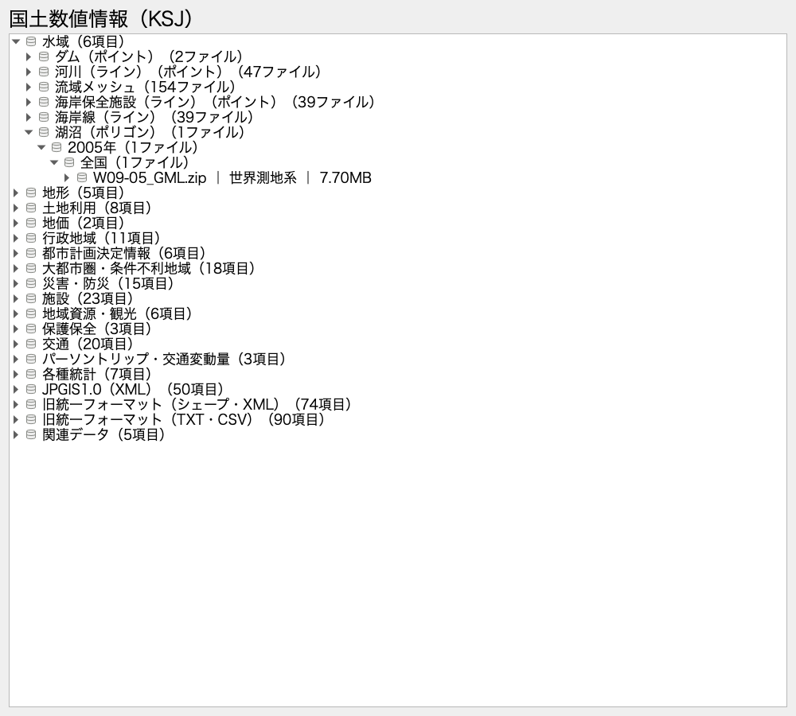

# ksj-provider — 国土数値情報 QGIS ブラウザプラグイン

[国土数値情報の公式サイト](https://nlftp.mlit.go.jp/ksj/)の現行形式・過年度版・旧形式を、QGISのブラウザパネルから探して利用できます。公式一覧の分類と配布ファイルの情報を同梱し、起動時に全データをダウンロードする必要はありません。

## 使い方

1. QGISのブラウザパネルで「国土数値情報（KSJ）」を展開します。
2. 水域・土地利用・災害／防災・施設・交通などの分類からデータを選びます。
3. 年度（新しい順）、地域・メッシュ、市区町村（該当データのみ）を選びます。
4. 形式・河川名・測地系・容量を確認して配布ファイルを展開します。
5. ZIP内部のレイヤーをダブルクリック、またはマップへドラッグします。GMLなど複数レイヤーを含むファイルは、展開して個別に選ぶこともできます。

全国一括・都道府県別・メッシュ別・河川別の配布を保持し、同じ地域のSHP／GML／GeoJSONや異なる測地系を省略しません。都市計画決定情報は都道府県→市区町村から選択できます。各ノードには項目数・ファイル数を表示します。

データセットを右クリックすると、公式の説明・属性定義・利用条件を開けます。配布ファイルを右クリックすると、その版の説明ページまたは原本ダウンロードを開けます。最新版と旧版で利用条件が異なる場合があるため、使用する版の条件を確認してください。



旧形式は「JPGIS1.0（XML）」「旧統一フォーマット（シェープ・XML）」「旧統一フォーマット（TXT・CSV）」にまとめています。Shapefile、GeoJSON、GDAL対応GML/XML、GeoPackage、CSV、ラスタなどはQGISで開けます。独自仕様の旧XML・TXTやLZHなど、GDALで直接読めない形式は原本をダウンロードして利用します。ZIP内部の入れ子ZIPにも対応します。

## 収録範囲と更新

カタログの取得日、一覧項目数、ページ数、重複を除いた配布ファイル数、取得エラーは [`ksj/catalog/index.json`](ksj/catalog/index.json) に記録しています。分類を展開するだけでは通信せず、データセット定義は選択時、リモートZIPは配布ファイルの展開時に読み込みます。公式サイトの配布状態や回線により、取得できない場合はブラウザにエラーを表示します。

収録範囲の照合・代表データの読み込み・テスト結果は[検証記録](specs/004-complete-catalog/verification.md)を参照してください。

更新にはPython 3.9以上とcurlを使用します。全配布ZIPのミラーは作成せず、公開HTMLと都市計画の配布一覧だけを収集します。

```bash
python3 scripts/update_catalog.py --refresh
```

- 現行一覧と3種類の旧形式一覧から、関連する詳細ページ・旧版を辿ります。
- 公開された正確なURL、年度、地域、市区町村、形式、測地系、容量、説明ページを保持します。
- HTMLの結合セル、和暦、相対URL、JavaScriptの配布一覧に対応します。
- 通信は直列化し、既定で1秒の間隔を空けます。`--request-delay`で調整できます。
- HTMLキャッシュは `.cache/ksj-catalog/` に保存します。`--refresh`を省略すると再利用します。
- 取得失敗時は通常の更新を中止し、既存カタログを上書きしません。画像認証を通常のデータページとして登録しません。
- 画像認証が出た場合は利用者がブラウザで認証を完了した後、`--retry-failed`で認証画面のキャッシュを再取得できます。
- `--allow-incomplete`は調査用です。失敗を明示した未完了カタログを出力するため、通常の更新には使用しません。

従来の3コレクション用更新スクリプトと `ksj/data_collections/` は旧データ形式の保守用です。ブラウザが参照する全データカタログは `scripts/update_catalog.py` で更新してください。

## 開発環境

プラグインの最低QGISバージョンは [`metadata.txt`](metadata.txt) を参照してください。QGIS付属Pythonとシステムサイトパッケージを共有し、別のPyQtをインストールしないでください。

```bash
uv venv --python /Applications/QGIS.app/Contents/MacOS/bin/python3 --system-site-packages
source setup_qgis_env.sh
QT_QPA_PLATFORM=offscreen .venv/bin/python -m pytest -q
QT_QPA_PLATFORM=offscreen .venv/bin/python -m pytest --cov=ksj --cov=scripts --cov-report=term-missing
uv run ruff check .
```

WindowsではQGISに付属するPythonのパスを指定してください。標準ライブラリだけを使う解析・分類テストは、QGISなしでも実行できます。

macOSでQGIS付属Pythonをターミナルから実行し、GDALが `unable to get local issuer certificate` を返す場合は、OS標準CAファイルの存在を確認して `CURL_CA_BUNDLE=/etc/ssl/cert.pem` を実行時に指定します。証明書検証を無効化する必要はありません。

```bash
python3 -m unittest tests.test_update_catalog tests.test_catalog
```

## 構成

| パス | 役割 |
| --- | --- |
| `ksj/catalog/index.json` | 分類・データセット索引・収集結果 |
| `ksj/catalog/*.json` | データセットごとの配布ファイル定義 |
| `ksj/catalog.py` | 遅延読み込み・年度や地域の分類 |
| `ksj/catalog_browser.py` | 分類・配布ファイル・ZIP内部・レイヤー追加のブラウザ項目 |
| `ksj/browser.py` | QGISプロバイダ・ルート項目 |
| `ksj/zip_scanner.py` | GDAL VSIによるZIP探索 |
| `scripts/update_catalog.py` | 公式カタログ生成 |
| `tests/` | HTML解析・分類・実QGISでの回帰テスト |
| `specs/004-complete-catalog/` | 全データ対応の計画と検証記録 |

パッケージ内部では相対インポートを使用し、Plugin Reloaderとの互換性を保ちます。

## ライセンス

プラグインはMITライセンスです。国土数値情報のデータは各版の使用許諾条件に従ってください。
