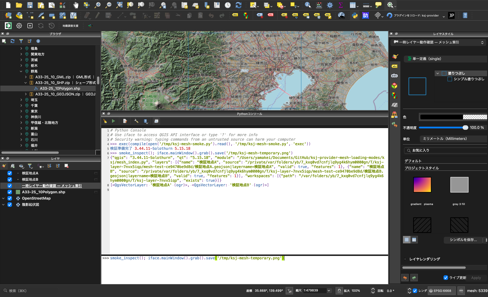

# メッシュ索引経路の追加方法対応（PR 2）実装計画

> **For agentic workers:** REQUIRED SUB-SKILL: Use superpowers:subagent-driven-development (recommended) or superpowers:executing-plans to implement this plan task-by-task. Steps use checkbox (`- [x]`) syntax for tracking.

**Goal:** メッシュ索引からの追加（`mesh_index.load_mesh`）が「追加方法・保存先」の設定に従うようにする。「一時レイヤー」では配布ファイル全体を一時ディレクトリへ取得し、レイヤーをすべて閉じた時点で削除する。保存先に完成済みデータがあれば通信せず再利用する。あわせてブラウザ経路の単体ファイル（ZIP でない配布）も一時レイヤーで保存済みデータを再利用する。

**Architecture:** `local_storage.saved_local_data(url, directory)` を追加し、「完成済みなら保存パス、なければ None」を通信なしで返す。`mesh_index.scan_resource` に一時ディレクトリの引数を足し、`load_mesh` が追加方法に応じて一時ディレクトリを作る。`finish_loading` は mode と一時ディレクトリを受け取り、追加したレイヤーへ `temporary_files.release_when_closed` で寿命を委ねる。PR 3 で `"kumoy"` の分岐を同じ場所に足せる形にしておく。

**Tech Stack:** Python 3.9 互換、PyQGIS、pytest + pytest-qgis、Ruff、Docker（`qgis/qgis:3.44` / `4.0-trixie` / `4.2-trixie`）

**Spec:** `docs/superpowers/specs/2026-10-24-kumoy-destination-design.md`（「メッシュ索引経路」「ブラウザ経路」の `prepare()`、「実装の分割」の 2 番目）

**前提:** PR 1（`docs/superpowers/plans/2026-10-24-encoding-detection.md`）がマージ済み、または同じブランチ上で完了していること。`temporary_files`・`messages`・`encoding_check` と、`conftest.temp_root`・`helpers.workspaces` を使う。

## Global Constraints

- 対応バージョンは QGIS 3.44 以上 4.x まで（Qt 5 / Qt 6 両対応）。Qt は `qgis.PyQt` 経由、enum は修飾付き。
- Python 3.9 互換。外部依存なし。パッケージ内は相対インポート。
- 文言・docstring・コメント・コミットメッセージは日本語。Conventional Commits。
- 「保存」方式の既存挙動（保存先の選択、追加済みの除外、`ksj/loaded/<url>` の記録）は変えない。
- 各タスクの最後に `uv run --no-sync ruff check .` と `uv run --no-sync ruff format .`（`uv.lock` が変わったら `git checkout uv.lock`）。
- クイック確認は `source setup_qgis_env.sh && QT_QPA_PLATFORM=offscreen .venv/bin/python -m pytest <対象> -q`、公式確認は Docker（`bash scripts/test-docker.sh` と `QGIS_TEST_IMAGE=qgis/qgis:4.0-trixie` / `4.2-trixie`）。
- コミットメッセージ末尾に次の 2 行を付ける。

```
Co-Authored-By: Claude Fable 5.1 <noreply@anthropic.com>
Claude-Session: https://claude.ai/code/session_01BYS3eSHL8hoWQqnddzMhgc
```

---

## ファイル構成

| ファイル | 役割 |
| --- | --- |
| `ksj/local_storage.py` | `saved_local_data(url, directory)` を追加 |
| `ksj/layer_loading.py` | `prepare()` の単体ファイル取得で保存済みデータを再利用 |
| `ksj/mesh_index.py` | `scan_resource(..., temporary=None)`、`load_mesh` の方式分岐、`finish_loading(..., mode, workspace)` |
| `tests/test_local_storage.py` `tests/test_lazy_loading.py` `tests/test_mesh_index.py` | 追加テスト |
| `README.md` | メッシュ索引と Processing の説明を更新 |

---

### Task 1: `local_storage.saved_local_data` — 完成済みデータの検出

**Files:**
- Modify: `ksj/local_storage.py`（`ensure_local_data` の直前に追加）
- Test: `tests/test_local_storage.py`

**Interfaces:**
- Produces: `local_storage.saved_local_data(url: str, directory: str) -> str | None`。ZIP の配布は展開済みフォルダ（完了マーカーあり）のパス、それ以外は取得済みファイルのパス。保存先が空・存在しない・URL が不正・未完成なら None。例外を投げず、通信しない。
- Consumes: 既存の `_destination`、`is_complete`、`DownloadError`

- [x] **Step 1: 失敗するテストを書く**

`tests/test_local_storage.py` の末尾に追加する。ファイル冒頭の import に `from pathlib import Path` と `from tests.helpers import mock_download, point_geojson, zip_bytes` が無ければ加える。

```python
def test_saved_local_data_reports_only_completed_data(tmp_path, monkeypatch):
    directory = str(tmp_path)
    archive_url = "https://example.org/data.zip"
    single_url = "https://example.org/point.geojson"
    assert local_storage.saved_local_data(archive_url, directory) is None
    assert local_storage.saved_local_data(archive_url, "") is None
    assert local_storage.saved_local_data(archive_url, str(tmp_path / "none")) is None
    assert local_storage.saved_local_data("ftp://example.org/x.zip", directory) is None

    mock_download(monkeypatch, zip_bytes([("point.geojson", point_geojson())]))
    root = local_storage.ensure_local_data(archive_url, directory)
    assert local_storage.saved_local_data(archive_url, directory) == root

    mock_download(monkeypatch, point_geojson().encode("utf-8"))
    assert local_storage.saved_local_data(single_url, directory) is None
    path = local_storage.ensure_local_data(single_url, directory)
    assert local_storage.saved_local_data(single_url, directory) == path

    # 完了マーカーの無い展開済みフォルダは未完成として扱う。
    (Path(root) / local_storage.STORAGE_METADATA / local_storage.COMPLETE_MARKER).unlink()
    assert local_storage.saved_local_data(archive_url, directory) is None
```

- [x] **Step 2: 失敗を確認する**

Run: `source setup_qgis_env.sh && QT_QPA_PLATFORM=offscreen .venv/bin/python -m pytest tests/test_local_storage.py -k saved_local_data -q`
Expected: FAIL（`AttributeError: module 'ksj.local_storage' has no attribute 'saved_local_data'`）

- [x] **Step 3: 実装する**

`ksj/local_storage.py` の `ensure_local_data` の直前に追加する。

```python
def saved_local_data(url, directory):
    """保存先に完成済みの配布データがあればそのパス。なければ None。通信しない。

    ZIP は展開済みフォルダ、それ以外は取得済みファイルを指す。一時レイヤーが
    保存済みデータを再利用するときに使い、保存先が無くても例外にしない。
    """
    if not directory or not Path(directory).is_dir():
        return None
    try:
        original = _destination(url, directory)
    except DownloadError:
        return None
    if original.suffix.lower() == ".zip":
        root = original.parent
        return str(root) if is_complete(root) else None
    if original.is_file() and original.stat().st_size > 0:
        return str(original)
    return None
```

- [x] **Step 4: テストと lint を通す**

Run: `source setup_qgis_env.sh && QT_QPA_PLATFORM=offscreen .venv/bin/python -m pytest tests/test_local_storage.py -q`
Expected: PASS

Run: `uv run --no-sync ruff check . && uv run --no-sync ruff format .`
Expected: エラーなし

- [x] **Step 5: コミット**

```bash
git add ksj/local_storage.py tests/test_local_storage.py
git commit -q -F - <<'EOF'
feat: 保存先の完成済み配布データを通信せず検出する

一時レイヤーとメッシュ索引経路が、取得済みのデータを再利用できるようにする。

Co-Authored-By: Claude Fable 5.1 <noreply@anthropic.com>
Claude-Session: https://claude.ai/code/session_01BYS3eSHL8hoWQqnddzMhgc
EOF
```

---

### Task 2: ブラウザ経路の単体ファイルでも保存済みデータを再利用する

**Files:**
- Modify: `ksj/layer_loading.py`（`prepare` の `else:` 分岐）
- Test: `tests/test_lazy_loading.py`

**Interfaces:**
- Consumes: Task 1 の `local_storage.saved_local_data`
- 変更なし: `prepare(task, url, member, name, mode, directory)` の引数と返り値

- [x] **Step 1: 失敗するテストを書く**

`tests/test_lazy_loading.py` の `test_temporary_layer_reuses_saved_data_without_deleting_it` の直後に追加する。

```python
def test_temporary_single_file_reuses_saved_download(
    qgis_app, qgis_new_project, storage_settings, http_data, temp_root
):
    http_data["body"] = point_geojson().encode("utf-8")
    url = http_data["url"].replace("data.zip", "point.geojson")
    item = catalog_browser.KsjResourceItem(
        None, "/test/single", {"filename": "point.geojson", "url": url}
    )
    (child,) = item.createChildren()
    storage_settings.mkdir()
    QgsSettings().setValue(local_storage.DIRECTORY_KEY, str(storage_settings))
    QgsSettings().setValue(local_storage.MODE_KEY, "save")
    assert child.handleDoubleClick()
    wait_for_layer_loading(qgis_app)
    (saved_layer,) = QgsProject.instance().mapLayers().values()
    saved = source_path(saved_layer)
    assert stored_in(saved_layer, storage_settings)
    QgsProject.instance().removeMapLayer(saved_layer.id())

    QgsSettings().setValue(local_storage.MODE_KEY, "temporary")
    before = len(http_data["requests"])
    assert child.handleDoubleClick()
    wait_for_layer_loading(qgis_app)
    (layer,) = QgsProject.instance().mapLayers().values()
    # 保存済みの単体ファイルを通信せず参照する。
    assert source_path(layer) == saved
    assert len(http_data["requests"]) == before
    QgsProject.instance().removeMapLayer(layer.id())
    qgis_app.processEvents()
    assert saved.is_file()
    assert not workspaces(temp_root)
```

- [x] **Step 2: 失敗を確認する**

Run: `source setup_qgis_env.sh && QT_QPA_PLATFORM=offscreen .venv/bin/python -m pytest tests/test_lazy_loading.py -k single_file_reuses -q`
Expected: FAIL（`source_path(layer) == saved` が一時ディレクトリのパスで失敗、または requests が増える）

- [x] **Step 3: 実装する**

`ksj/layer_loading.py` の `prepare` の `else:` 分岐を次にする。

```python
        else:
            # 単体ファイルでも、保存済みがあれば一時レイヤーは通信せず再利用する。
            saved = (
                local_storage.saved_local_data(url, directory) if temporary else None
            )
            path = saved or local_storage.ensure_local_data(
                url, destination, task.isCanceled, task.setProgress
            )
```

- [x] **Step 4: テストと lint を通す**

Run: `source setup_qgis_env.sh && QT_QPA_PLATFORM=offscreen .venv/bin/python -m pytest tests/test_lazy_loading.py -q`
Expected: PASS

Run: `uv run --no-sync ruff check . && uv run --no-sync ruff format .`
Expected: エラーなし

- [x] **Step 5: コミット**

```bash
git add ksj/layer_loading.py tests/test_lazy_loading.py
git commit -q -F - <<'EOF'
fix: 一時レイヤーの単体ファイル取得でも保存済みデータを再利用する

ZIP 内の選択データと同じく、保存先に取得済みの単体ファイルがあれば通信しない。

Co-Authored-By: Claude Fable 5.1 <noreply@anthropic.com>
Claude-Session: https://claude.ai/code/session_01BYS3eSHL8hoWQqnddzMhgc
EOF
```

---

### Task 3: メッシュ索引経路を「一時レイヤー」に対応させる

**Files:**
- Modify: `ksj/mesh_index.py`（import、`scan_resource`、`finish_loading`、`_finish_loading`、`load_mesh`）
- Test: `tests/test_mesh_index.py`

**Interfaces:**
- Produces: `mesh_index.scan_resource(task, url, directory, temporary=None)`（`temporary` は一時ディレクトリのパス文字列。指定時は保存済みがあればそれを、なければ一時ディレクトリへ取得）、`mesh_index.finish_loading(task, layer_id, url, exception, result=None, mode="save", workspace=None)`、`mesh_index._finish_loading(task, layer_id, url, exception, result, mode, workspace) -> bool`（一時ディレクトリの寿命をレイヤーへ委ねたら True）
- Consumes: Task 1 の `saved_local_data`、PR 1 の `temporary_files.workspace/cleanup/release_when_closed`
- PR 3 は `load_mesh` の `mode` 判定の直後に `ready()` 確認を、`_finish_loading` の `selected` 確定後に `"kumoy"` の分岐を足す。

- [x] **Step 1: 既存テストのスタブを新しいシグネチャに合わせる**

`tests/test_mesh_index.py` の `test_failure_is_reported_and_allows_retry` 内の `fail` を次にする。

```python
    def fail(task, url, directory, temporary=None):
        raise RuntimeError("テスト用の接続失敗")
```

- [x] **Step 2: 失敗するテストを書く**

`tests/test_mesh_index.py` の冒頭に `from pathlib import Path` を加え、`from qgis.core import (...)` に `QgsSettings` を、`from ksj import catalog, catalog_browser, local_storage, mesh_index` に `temporary_files` を、`from tests.helpers import ...` に `workspaces` を加える。末尾に追加する。

```python
def counting_download(monkeypatch):
    """local_resource が差し替えた取得関数を包み、呼ばれた URL を集める。"""
    fetch = local_storage._download
    calls = []

    def download(url, path, *args):
        calls.append(url)
        fetch(url, path, *args)

    monkeypatch.setattr(local_storage, "_download", download)
    return calls


def loaded_layers(index):
    return sorted(
        (layer for layer in QgsProject.instance().mapLayers().values() if layer != index),
        key=lambda layer: layer.name(),
    )


def test_temporary_mode_fetches_into_workspace_and_removes_it_when_layers_close(
    qgis_app, qgis_new_project, tmp_path, monkeypatch, storage_settings, temp_root, layer_choices
):
    QgsSettings().setValue(local_storage.MODE_KEY, "temporary")
    resource = local_resource(tmp_path, monkeypatch)
    layer_choices([0, 1])
    index = mesh_index.add_mesh_index("道路", [resource])
    mesh_index.load_mesh(index.id(), next(index.getFeatures()).id())
    wait_for_loads(qgis_app)
    layers = loaded_layers(index)
    assert [layer.name() for layer in layers] == ["one", "two"]
    (workspace,) = workspaces(temp_root)
    for layer in layers:
        assert workspace in Path(layer.source().split("|")[0]).parents
        assert layer.customProperty(mesh_index.RESOURCE_PROPERTY) == resource["url"]
    # 保存先には何も残さない。
    assert not list(tmp_path.glob("data-*"))
    project = QgsProject.instance()
    project.removeMapLayer(layers[0].id())
    qgis_app.processEvents()
    assert workspaces(temp_root) == [workspace]
    project.removeMapLayer(layers[1].id())
    qgis_app.processEvents()
    assert not workspaces(temp_root)


def test_temporary_mode_reuses_saved_distribution_without_downloading(
    qgis_app, qgis_new_project, tmp_path, monkeypatch, storage_settings, temp_root, layer_choices
):
    resource = local_resource(tmp_path, monkeypatch)
    downloads = counting_download(monkeypatch)
    layer_choices([0, 1], [0, 1])
    index = mesh_index.add_mesh_index("道路", [resource])
    feature_id = next(index.getFeatures()).id()
    mesh_index.load_mesh(index.id(), feature_id)
    wait_for_loads(qgis_app)
    project = QgsProject.instance()
    for layer in loaded_layers(index):
        project.removeMapLayer(layer.id())
    assert downloads == [resource["url"]]

    QgsSettings().setValue(local_storage.MODE_KEY, "temporary")
    mesh_index.load_mesh(index.id(), feature_id)
    wait_for_loads(qgis_app)
    layers = loaded_layers(index)
    assert [layer.name() for layer in layers] == ["one", "two"]
    assert downloads == [resource["url"]]
    (saved_root,) = tmp_path.glob("data-*")
    for layer in layers:
        assert saved_root in Path(layer.source().split("|")[0]).parents
    for layer in layers:
        project.removeMapLayer(layer.id())
    qgis_app.processEvents()
    assert saved_root.is_dir()
    assert not workspaces(temp_root)


def test_temporary_mode_never_asks_for_directory(
    qgis_app, qgis_new_project, tmp_path, monkeypatch, storage_settings, temp_root
):
    QgsSettings().setValue(local_storage.MODE_KEY, "temporary")
    monkeypatch.setattr(local_storage, "download_directory", lambda: "")
    monkeypatch.setattr(
        local_storage,
        "choose_download_directory",
        lambda *args: pytest.fail("一時レイヤーでは保存先を尋ねない"),
    )
    resource = local_resource(tmp_path, monkeypatch, ("one",))
    index = mesh_index.add_mesh_index("道路", [resource])
    mesh_index.load_mesh(index.id(), next(index.getFeatures()).id())
    wait_for_loads(qgis_app)
    (layer,) = loaded_layers(index)
    assert layer.featureCount() == 1
    (workspace,) = workspaces(temp_root)
    assert workspace in Path(layer.source().split("|")[0]).parents


def test_temporary_mode_offers_all_layers_again_and_cancel_removes_workspace(
    qgis_app, qgis_new_project, tmp_path, monkeypatch, storage_settings, temp_root, layer_choices
):
    QgsSettings().setValue(local_storage.MODE_KEY, "temporary")
    resource = local_resource(tmp_path, monkeypatch)
    opened = layer_choices([0], None)
    index = mesh_index.add_mesh_index("道路", [resource])
    feature_id = next(index.getFeatures()).id()
    mesh_index.load_mesh(index.id(), feature_id)
    wait_for_loads(qgis_app)
    assert [layer.name() for layer in loaded_layers(index)] == ["one"]
    # 一時レイヤーは追加済みを除外せず、2 回目も全レイヤーを候補に出す。
    mesh_index.load_mesh(index.id(), feature_id)
    wait_for_loads(qgis_app)
    assert len(opened) == 2 and len(opened[1][0]) == 2
    assert [layer.name() for layer in loaded_layers(index)] == ["one"]
    # キャンセルした 2 回目の一時ディレクトリは残らない。
    assert len(workspaces(temp_root)) == 1
```

- [x] **Step 3: 失敗を確認する**

Run: `source setup_qgis_env.sh && QT_QPA_PLATFORM=offscreen .venv/bin/python -m pytest tests/test_mesh_index.py -k temporary_mode -q`
Expected: FAIL（保存先へ取得される、または `download_directory` が空でエラー）

- [x] **Step 4: `mesh_index` を実装する**

`ksj/mesh_index.py` の `from . import catalog, encoding_check, local_storage, zip_scanner` に `temporary_files` を加える。

`scan_resource` の先頭を次にする（`suffix` の検査より後、`if suffix == ".zip":` より前の `local_path = ...` を置き換える）。

```python
def scan_resource(task, url, directory, temporary=None):
    """ワーカーで取得・展開し、通常ファイルのパスをGUIへ戻す。

    temporary（一時ディレクトリのパス）を渡すと、保存先に完成済みデータがある
    場合だけそれを使い、なければ一時ディレクトリへ取得する。
    """
    suffix = zip_scanner.download_suffix(url)
    if suffix not in zip_scanner.SUPPORTED_EXTENSIONS:
        raise ValueError(
            "この形式は直接読み込めません。ブラウザから原本をダウンロードしてください。"
        )
    saved = local_storage.saved_local_data(url, directory) if temporary else None
    local_path = saved or local_storage.ensure_local_data(
        url,
        temporary or directory,
        is_canceled=task.isCanceled,
        progress=task.setProgress,
    )
```

`finish_loading` と `_finish_loading` を次に置き換える。

```python
def finish_loading(
    task, layer_id, url, exception, result=None, mode="save", workspace=None
):
    """完了時の処理。一時ディレクトリの寿命をレイヤーへ委ねなかった場合はここで削除する。"""
    released = False
    try:
        released = _finish_loading(
            task, layer_id, url, exception, result, mode, workspace
        )
    finally:
        if workspace is not None and not released:
            temporary_files.cleanup(workspace)
        if _pending.get(url) is task:
            _pending.pop(url)


def _finish_loading(task, layer_id, url, exception, result, mode, workspace):
    """レイヤーを追加する。一時ディレクトリの寿命をレイヤーへ委ねたら True を返す。"""
    if not _is_current(task, layer_id, url):
        return False
    if exception is not None:
        notify(f"データを取得できません: {exception}", warning=True)
        return False
    if result is None:
        return False
    ogr = QgsProviderRegistry.instance().providerMetadata("ogr")
    # 一時ディレクトリはパスが毎回変わるため、追加済みの除外は保存方式だけで行う。
    present = loaded_sources(url) if mode == "save" else set()
    candidates, sources = [], []
    for provider, path, name in result["layers"]:
        if provider == "ogr":
            uri = ogr.encodeUri({"path": path, "layerName": name})
        else:
            uri = path
        sources.append(uri)
        if uri not in present:
            candidates.append((provider, path, name, uri))
    if not candidates:
        if result["failed"]:
            notify(f"読み込み失敗: {', '.join(result['failed'])}", warning=True)
        else:
            notify(ALREADY_ADDED_MESSAGE)
        return False
    # 複数レイヤーの配布なら、残りが1件でも利用者に確認してから追加する。
    selected = choose_layers(candidates) if len(result["layers"]) > 1 else candidates
    # モーダル画面の表示中もイベントが処理されるため、状態を再確認する。
    if not selected or not _is_current(task, layer_id, url):
        return False
    project = QgsProject.instance()
    index_layer = project.mapLayer(layer_id)
    added, failed = [], list(result["failed"])
    # 同じ配布の二重起動は _pending が防ぐため、候補はモーダル後も未追加のままである。
    for provider, path, name, uri in selected:
        layer_class = QgsVectorLayer if provider == "ogr" else QgsRasterLayer
        layer = layer_class(uri, name, provider)
        if not layer.isValid():
            failed.append(name)
            continue
        if provider == "ogr":
            encoding_check.apply_detected_encoding(layer)
        layer.setCustomProperty(RESOURCE_PROPERTY, url)
        added.append(layer)
    released = workspace is not None and bool(added)
    if released:
        # プロジェクトへ追加する前に寿命を委ねる。以降の例外で参照先を消さない。
        temporary_files.release_when_closed(workspace, added)
    project.addMapLayers(added)
    if utils.iface is not None:
        utils.iface.setActiveLayer(index_layer)
    if failed:
        notify(
            f"{len(added)}レイヤーを追加。読み込み失敗: {', '.join(failed)}",
            warning=True,
        )
    else:
        if mode == "save":
            # 選んだ分ではなく配布の全レイヤーを記録し、load_mesh が全件追加済みの判定に使う。
            index_layer.setCustomProperty(f"ksj/loaded/{url}", sources)
        notify(f"{len(added)}レイヤーを追加しました。続けて別のメッシュを選べます。")
    return released
```

`load_mesh` の `directory = (...)` 以降を次に置き換える。

```python
    mode = local_storage.loading_mode()
    directory = local_storage.download_directory()
    if mode == "save" and not directory:
        directory = local_storage.choose_download_directory()
        if not directory:
            return
    # 一時レイヤーは一時ディレクトリへ取得し、保存先は完成済みデータの再利用にだけ使う。
    workspace = temporary_files.workspace() if mode != "save" else None
    task = QgsTask.fromFunction(
        f"KSJ: {resource['filename']}",
        scan_resource,
        url,
        directory,
        workspace.name if workspace is not None else None,
        on_finished=lambda exception, result=None: finish_loading(
            task, layer_id, url, exception, result, mode=mode, workspace=workspace
        ),
    )
    task.setDependentLayers([layer])
    _pending[url] = task
    QgsApplication.taskManager().addTask(task)
    notify(f"読み込み中: {resource['filename']}")
```

- [x] **Step 5: テストと lint を通す**

Run: `source setup_qgis_env.sh && QT_QPA_PLATFORM=offscreen .venv/bin/python -m pytest tests/test_mesh_index.py tests/test_local_storage.py -q`
Expected: PASS（保存方式の既存テストも含めて）

Run: `uv run --no-sync ruff check . && uv run --no-sync ruff format .`
Expected: エラーなし

- [x] **Step 6: コミット**

```bash
git add ksj/mesh_index.py tests/test_mesh_index.py
git commit -q -F - <<'EOF'
feat: メッシュ索引からの追加を追加方法の設定に従わせる

一時レイヤーでは配布ファイル全体を一時ディレクトリへ取得し、レイヤーをすべて
閉じた時点で削除する。保存先に完成済みデータがあれば通信せず再利用する。
保存方式の挙動は変えない。

Co-Authored-By: Claude Fable 5.1 <noreply@anthropic.com>
Claude-Session: https://claude.ai/code/session_01BYS3eSHL8hoWQqnddzMhgc
EOF
```

---

### Task 4: README の更新と全体検証

**Files:**
- Modify: `README.md`（「追加方法・保存先と再利用」「地図のメッシュをクリックして追加する」「Processingツールボックスから利用する」）

- [x] **Step 1: README を更新する**

「追加方法・保存先と再利用」の「一時レイヤーとして追加」の箇条書きの末尾に次の文を加える。

```
メッシュ索引から追加する場合は配布ファイル全体を一時フォルダへ取得します。保存先に取得済みのデータがあれば、どちらの方式でも通信せず再利用します。
```

「地図のメッシュをクリックして追加する」の手順 3 の末尾「保存先が未設定なら、このとき一度だけフォルダを選びます。」を次にする。

```
追加方法・保存先の設定に従います。「フォルダに保存して追加」で保存先が未設定なら、このとき一度だけフォルダを選びます。
```

手順 5 の「同じ配布ファイルを再度選ぶと、まだ追加していないレイヤーを選択できます。」を次にする。

```
「フォルダに保存して追加」では、同じ配布ファイルを再度選ぶと、まだ追加していないレイヤーを選択できます。「一時レイヤーとして追加」では毎回すべてのレイヤーを候補に出します。
```

「Processingツールボックスから利用する」の 2 段落目を次にする。

```
追加方法・保存先の設定は、ブラウザのファイル項目とメッシュ索引からの追加に適用します。Processingの取得処理は、指定フォルダに配布全体を保存する処理です。
```

- [x] **Step 2: 全体検証**

Run: `bash scripts/test-docker.sh`
Expected: 全テスト PASS

Run: `QGIS_TEST_IMAGE=qgis/qgis:4.0-trixie bash scripts/test-docker.sh && QGIS_TEST_IMAGE=qgis/qgis:4.2-trixie bash scripts/test-docker.sh`
Expected: 全テスト PASS

Run: `uv run --no-sync ruff check . && uv run --no-sync ruff format --check .`
Expected: エラーなし

Run: README「Qt6 互換チェック」の docker コマンド、続けて `grep -i "ksj/mesh_index\|ksj/local_storage\|ksj/layer_loading" pyqt6_checker.log || echo "指摘なし"`
Expected: 「指摘なし」

- [x] **Step 3: コミット**

```bash
git add README.md
git commit -q -F - <<'EOF'
docs: メッシュ索引からの追加が追加方法の設定に従うことを記載

Co-Authored-By: Claude Fable 5.1 <noreply@anthropic.com>
Claude-Session: https://claude.ai/code/session_01BYS3eSHL8hoWQqnddzMhgc
EOF
```

- [x] **Step 4: 実機確認と PR**

QGIS 3.44（`/Applications/QGIS-LTR.app`）で、追加方法を「一時レイヤー」にしてメッシュ索引からデータを追加し、タスクの進捗、追加後のレイヤー、レイヤーを閉じた後に `ksj-layer-*` が残らないことを確認する。確認項目と結果は文章で利用者に報告する。PR 本文に影響範囲、テスト結果、設計書へのリンクを書く。作業ブランチは PR 1 のブランチから派生させる（`feat/mesh-loading-modes`）。


## 実装・検証結果（2026-10-25）

PR1 のマージ済み `main`（`ee44a99`）を基点に `feat/mesh-loading-modes` で実装した。

計画のコード例からは、次の点を補正した。

- `load_mesh()` の事前の追加済み判定も保存方式だけに限定した。保存方式から一時方式に切り替えた際も、全レイヤーを候補に出す。
- 一時ディレクトリの後片付けを `_finish_loading()` 内の `finally` に置いた。レイヤーへ寿命を委ねた後の通知例外でも、参照中のファイルを削除しない。
- `saved_local_data()` は URL 解析の `ValueError` と保存先参照の `OSError` も再利用不可として扱い、一時領域への取得を妨げない。
- README の重複追加を防ぐ説明を、保存方式に限定した。

| 検証 | 結果 |
| --- | --- |
| Docker QGIS 3.44 | 317 passed、全体カバレッジ 90% |
| Docker QGIS 4.0 | 317 passed、全体カバレッジ 90%（再実行） |
| Docker QGIS 4.2 | 317 passed、全体カバレッジ 90% |
| Ruff check / format --check | PASS |
| pyqgis4-checker --dry_run | 指摘なし |
| 独立コードレビュー | 修正指摘なし。関連23テストもPASS |

QGIS 4.0 の初回全体実行は、既存の `test_failure_leaves_no_completed_file_and_can_retry[html]` 実行中にセグメンテーション違反で終了した。コード変更なしで当該ファイル24テストと全317テストの再実行が通った。原因は特定できていない。各バージョンの警告2件は GDAL の将来の例外設定と、重複ZIP項目を意図的に作る既存テストによるもの。

ホストでのブラウザ単体テストは、初回取得が15秒の待機時間を超えたため、標準の Docker で修正前の失敗と修正後の成功を確認した。

実機 QGIS 3.44.11 / Qt 5.15.18 では、最新実装を別名パッケージとして読み込み、ローカルHTTPで配布する検証用ZIPを使った。保存先未設定・一時方式で地図のメッシュをクリックし、読み込み中の表示、選択ダイアログ、2レイヤーの追加を確認した。両レイヤーが同じ `ksj-layer-*` 内のファイルを参照し、1枚を閉じても一時領域が残り、最後を閉じると削除された。検証用レイヤーと設定は終了時に除去した。



kumoy 方式は PR3 の範囲とする。QGIS の「レイヤーを複製」で作った複製を寿命追跡の対象に含めない既存の制限は維持する。
