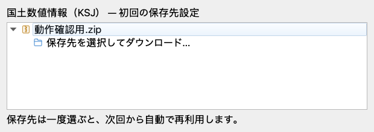

# 配布データの取得・展開 — 検証記録

## 対象

初回だけ選択した保存先を記憶し、未取得の配布ZIPを一時取得・展開してから通常ファイルを表示する。ブラウザ展開、ダブルクリック、ドラッグ、メッシュ索引からの追加は、展開済みの実ファイルパスを参照する。

- 実装: `ksj/local_storage.py`、`ksj/catalog_browser.py`、`ksj/browser.py`、`ksj/mesh_index.py`、`ksj/zip_scanner.py`
- 現行設計: [展開したファイルからレイヤーを追加する](../../docs/superpowers/specs/2026-10-22-extracted-files-design.md)
- 現行手順: [展開済みファイル保存の実装計画](../../docs/superpowers/plans/2026-10-22-extracted-files.md)
- 環境: macOS、Python 3.9.5、QGIS 3.42.1、Qt 5.15.2。QGIS 4 / Qt 6は実機未検証。

## 動作の確認

| 要件 | 証拠 |
| --- | --- |
| 保存先を初回だけ選択・以後記憶 | `test_choose_directory_remembers_and_cancel_keeps_previous`、`test_mesh_downloads_once_and_uses_local_sources` |
| 初回設定と右クリックからの保存先変更 | `test_browser_model_first_selection_refreshes_to_local_layers`。実BrowserModelで、新規URIの切り替えと追加済みレイヤーの維持を確認 |
| ZIPを展開し、通常ファイルと付属ファイルを残す | `test_extracts_files_and_sidecars_and_reuses_without_zip`。ZIP・一時フォルダが残らないことも確認 |
| Shapefileの形状・属性を維持 | `test_shapefile_geometry_and_attributes_survive_extraction`。実OGRで作成した複数ファイルを展開してQGISで検証 |
| 入れ子ZIPの解凍 | `test_nested_archives_become_folders`、`test_nested_archive_table_is_readable` |
| UTF-8・CP932の日本語ファイル名 | `test_extracts_files_and_sidecars_and_reuses_without_zip`、`test_filename_without_utf8_flag_is_restored`（UTF-8フラグなしのUTF-8名・CP932名） |
| 旧方式の保存ZIPを取得せず展開 | `test_existing_zip_is_extracted_without_download_or_deletion`。既存プロジェクト用の原本を保持 |
| 再利用時に通信しない | `test_download_reuses_completed_file_without_requests`。ローカルHTTPのGET回数を確認 |
| 同時取得・同名URLの衝突防止 | `test_same_url_concurrent_download_only_fetches_once`、`test_different_urls_with_same_filename_do_not_collide` |
| 配布ファイル名で見分けられる保存フォルダ | `test_storage_folder_is_named_after_distribution_file`。`<ファイル名>-<URL識別子12桁>/` に保存し、同名の別配布は識別子で分かれる |
| 残ったロックで固まらない | `test_lock_held_elsewhere_times_out_with_guidance`。待ち時間の上限（5分）を超えると通信せずにロックファイルの場所を案内し、解放後は通常どおり取得 |
| 失敗・中止時に未完成データを残さない | HTTP 404、途中切断、空ファイル、HTML、破損ZIPに加え、展開中のキャンセル・ディスク不足をテスト |
| 強制終了で残った作業フォルダの回収 | `test_stale_staging_folder_is_removed_on_next_download`。同じURLのロック取得後に `download-*.part` を削除 |
| 消えた保存先を作り直さない | `test_missing_directory_is_not_recreated`。取り外した外部ドライブなどの保存先には取得せず、設定し直しを案内 |
| 不正なZIPの展開防止 | パス逸脱5種類、シンボリックリンク、重複ファイル名、入れ子展開先の衝突、深すぎる入れ子を検証 |
| 通常フォルダの走査範囲 | `test_local_directory_scan_stays_inside_root`。GDALの `.` / `..` による再帰を再現して除外 |
| 通常ファイルURIと通信なしの再読込 | `test_browser_download_and_project_reopen_never_reconnect`、`test_mesh_downloads_once_and_uses_local_sources`。`/vsi` を含まず実ファイルが存在することを確認 |
| プロジェクトとデータの移動 | `test_project_can_move_with_extracted_files`。通常ZIP・入れ子ZIPの両方で、移動後も地物と属性が読める |
| 既存操作 | ブラウザ・メッシュの回帰テスト。GML等の複数レイヤー、ラスタ、削除後の再追加、重複抑止も確認 |

検証では国の配布サーバーへデータ取得リクエストを送らず、ローカルHTTPと小さな試験ZIPを使用した。

## 表示の確認

初回の保存先設定は従来と同じ。実QGISブラウザモデルをQtウィジェットで表示した確認用画像（オフスクリーン描画、検証データ）。



## チェック結果

```bash
source setup_qgis_env.sh
QT_QPA_PLATFORM=offscreen .venv/bin/python -m pytest -q --cov=ksj --cov=scripts --cov-report=term-missing
.venv/bin/ruff check .
git diff --check
```

- 全テスト: **142 passed**（47.91秒）。警告は既存pytest-covの非推奨警告2件、重複名の不正ZIPを生成するテストの警告1件。
- カバレッジ: `ksj` と `scripts` 合計 **84%**。
- Ruff: **All checks passed**（`uv run --frozen ruff check .` でも確認）。
- `git diff --check`: 成功。

Qtのネイティブワーカースレッドで動く部分は、この環境のPythonカバレッジに一部反映されない。主要経路は実HTTPの取得回数、完成ファイル、一時ファイル、レイヤーの地物をそれぞれ検証している。

## 実装上の判断と制約

- 保存した通常ファイルは自動更新・自動削除しない。一時取得するZIPは処理後に削除する。
- 再取得は対象配布のサブフォルダ（配布ファイル名で始まる）を削除して行う。保存済みZIPも残っている場合があるため、展開フォルダだけの削除では再取得せず同じZIPから展開する。
- 同じデータのロックは同一ホストならプロセス終了時にQtが回収する。他ホストや取り外した共有先に残ったロックは回収できないため、5分で待ちを打ち切り、ロックファイルの場所を案内する。
- 保存先変更では既存ファイルを移動しない。追加済みレイヤーが参照する元の保存先を保持する。
- 既存のリモート参照・ZIP参照レイヤーは自動変更しない。再追加すると通常ファイル参照になる。
- 初回の処理には一時ZIPと展開後データの両方を保持する空き容量が必要。
- Context7は月間上限で取得できなかったため、[Python 3.9 zipfile公式文書](https://docs.python.org/3.9/library/zipfile.html)と実QGIS環境で確認した。

## レビュー

別エージェントによる実装・テストのレビューで新規の不具合指摘なし。実GDALで生成した日本語名GMLとXSDをZIP化・展開し、両ファイルの保持、有効なレイヤー、1地物、属性値の一致を追加確認した。

既存レイヤーの自動移行は明示的に対象外。UTF-8/CP932以外のファイル名の文字化け補正は追加せず、元のデコード結果へフォールバックする。Windows・ネットワーク共有先は実機未検証のため互換性を断定しない。READMEと検証記録は実装者が最終状態を確認した。
